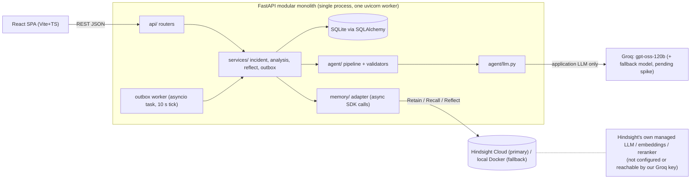

# architecture.md  (v1.1)

## 1. Principles
1. **Hindsight finds candidates; the app DB verifies them.** Hindsight provides associative recall and synthesis. SQLite is the source of truth for incident status, root-cause confirmation, outcomes and what has been retained. The agent may only cite incidents that exist in SQLite as `resolved`.
2. **Contract first.** `backend/app/contracts.py` (Pydantic v2) is canonical; frontend types are generated from OpenAPI.
3. **One seam per external system.** Only `app/memory/` imports the Hindsight SDK; only `app/agent/llm.py` imports the LLM client. Both have `fake` implementations (with fault injection) so every workstream runs before real services are ready. **Two different LLMs exist and must not be confused:** the *application* LLM (Groq, configured by `GROQ_API_KEY`/`LLM_MODEL`) and *Hindsight's internal* extraction/reflect model (managed by Hindsight Cloud; not configurable by us — hindsight-integration §2).
4. **No framework tax.** Plain functions for the pipeline; no agent framework; no tool calling (organiser warns about function-calling errors) — JSON-schema responses validated by Pydantic with one repair retry.
5. **Advisory, evidence-labelled output.** Every claim carries `OBSERVED|HISTORICAL|INFERRED|TO_VERIFY`; recommendations never claim certainty.
6. **Retention can never block or lose a resolution.** Resolve commits to SQLite first; Hindsight is reached later through a SQLite outbox.

## 2. High-level architecture

There is **no arrow from Hindsight to Groq**: on Cloud, Hindsight's models are managed and no BYO-key path is documented; on self-hosted Hindsight the server has its own `HINDSIGHT_API_LLM_*` configuration which is separate from our app settings.

## 3. Component responsibilities
| Component | Owns | Must not |
|---|---|---|
| `api/` | HTTP, validation, error mapping, envelope | business logic |
| `services/` | orchestration, transactions, enrichment (candidate → DB incident), outbox worker, reflect validation, derived `retain_status` | call SDKs directly |
| `db/` | models, repo functions, seed loader | know about Hindsight |
| `memory/` | adapter: retain/recall/reflect, query construction, narrative templating, hit normalisation + provenance + dedup/consolidation, timeouts, error classification; `FakeMemoryService` | leak SDK types; touch SQLite or the outbox; delete/clear anything |
| `agent/` | extraction + analysis prompts, schema validation, repair retry, label validators | touch DB or Hindsight |
| `frontend/` | UI only; typed API client; safe Markdown rendering | hold secrets; render raw HTML |

## 4. Analysis flow — `POST /api/incidents/{id}/analyze`
```mermaid
sequenceDiagram
  participant UI
  participant S as AnalysisService
  participant A as Agent
  participant M as MemoryAdapter
  participant H as Hindsight
  participant D as SQLite
  UI->>S: analyze(id, use_memory)
  S->>A: extract(incident)  [LLM call 1: symptoms, entities, error signatures, missing info]
  alt use_memory
    S->>M: recall_for_incident(incident, extraction)
    M->>H: arecall x3 concurrently (narrative, error signature, failed-fix)
    H-->>M: hits
    M-->>S: RecallResult(status ok|empty|unavailable, candidates, invalid_refs)
    S->>D: verify candidate IDs exist & resolved; enrich with record, root cause+status, steps, outcome
  end
  S->>A: analyse(incident, extraction, enriched candidates)  [LLM call 2: AnalysisDraft]
  S->>S: merge app-computed fields from DB; run validators (api-contracts "Evidence-label rules")
  S->>D: persist analysis + memory_events
  S-->>UI: AnalysisReport
```
**Memory-OFF = identical pipeline with only the recall step skipped** (same model, prompts, temperature, incident). The A/B is therefore controlled; its measured outcome is reported as measured (demo-plan §6), never assumed.

## 5. Memory lifecycle
| Event | Action | Notes |
|---|---|---|
| Incident submitted / analysed | **No retain.** | Unverified hypotheses and agent text must not become "memory". |
| Engineer resolves incident | SQLite commit **+ outbox row `pending` in the same transaction**; worker retains one narrative (`document_id = INC-###`) | Resolve returns immediately with `retain_status="pending"`. |
| Root cause corrected later (UI is P1) | SQLite: new root-cause row, old `superseded`, `revision+1`; outbox row `kind=correction`; full corrected narrative re-retained with same `document_id`, `update_mode="replace"` | data-model §4. Until it succeeds, recalled snippets for that incident carry the "corrected after this memory was recorded" badge. |
| Engineer feedback on a recommendation (P1) | retain short note | |
| Analysis report text | **Never retained.** | |
| New analysis | **Recall** (3 queries) | |
| Pattern view | **Reflect — manual button only** | see below |

**Resolve + retain flow (canonical lifecycle in data-model §3):**
```mermaid
sequenceDiagram
  participant UI
  participant R as incident_service.resolve
  participant D as SQLite
  participant W as outbox worker
  participant M as MemoryAdapter
  UI->>R: POST resolve
  R->>D: BEGIN; save resolution+steps+root cause; incident=resolved; INSERT outbox(pending, frozen narrative); COMMIT
  R-->>UI: 200 IncidentDetail (retain_status=pending)
  R-)W: kick()
  W->>D: claim: pending→in_progress (compare-and-set)
  W->>M: retain(narrative, document_id)
  alt ok
    W->>D: in_progress→succeeded   (retain_status=synced)
  else transient error and attempts<5
    W->>D: in_progress→pending, next_attempt_at=backoff
  else permanent / attempts exhausted
    W->>D: in_progress→failed      (retain_status=failed; engineer can retry)
  end
```
Process death: before the first attempt → row is still `pending` and is picked up at next boot/tick; mid-attempt → lease expiry (180 s) returns it to `pending`; after Hindsight accepted but before `succeeded` → the retry re-sends the same `document_id`, which upserts (no duplicate) [D; confirm L7]. Delivery is at-least-once with idempotent upsert. `retain_status` is *derived* from the outbox on every read, so the API can never contradict the DB, and the Memory Trace renders pending/succeeded/failed from outbox rows (events are history only).

**Why Reflect is manual (decision, replaces "auto-refresh after each resolve"):** Reflect latency and cost are unmeasured (L9; billed per call); an automatic call after each resolve would either block resolve or race several concurrent generations; and an out-of-date automatic result would look like a fresh insight. Instead: the last successful reflection is stored with `generated_at` and the count of resolved incidents it covered; `GET /api/reflection` returns it with `freshness` (`fresh|stale|none`); the Patterns page shows "generated at … from N of M resolved incidents — refresh" and a failed refresh leaves the previous result visible, marked stale with `last_attempt` details. Reflect failure, timeout or 402 never affects incident resolution.

## 6. Evidence integrity and grounding validation
### 6.1 Recall candidates (preventing false historical associations)
1. Recall returns *hits*; the adapter normalises, deduplicates and consolidates them into *candidates* per incident (hindsight-integration §6). A hit is **not** an incident and a candidate is **not** a conclusion.
2. `services/` accepts a candidate only if its ID matches `^INC-\d{3}$`, exists in SQLite and is `resolved`; others are dropped and counted (`invalid_refs`, `unknown_refs`).
3. The LLM rates each candidate `strong|partial|weak|unrelated` and lists matching features **and differences**.
4. Root cause, outcomes, attempts and resolution shown to users come from SQLite (`source:"db"`). Memory snippets are labelled "memory snippet" and are never the source of a "confirmed" statement.
5. If no candidate is ≥ partial → UI shows "No relevant historical memory found" — never invented history.
6. Prompt rule: similar symptoms ≠ same cause; always include a TO_VERIFY step "what would distinguish them"; if key metadata is absent (e.g. library version) list it first in `missing_information` and do **not** assert the historical cause for the new incident.

### 6.2 Analysis validator (`agent/validators.py` + `services/`)
Applies the label rules in api-contracts ("Evidence-label rules 1–7"): refs ⊆ DB-verified candidates; HISTORICAL forbidden unless `memory.status=ok`; suspected causes never rendered as confirmed; unlabelled → `TO_VERIFY`; every repair is recorded in `validation_actions` (and checked by T-tests).

### 6.3 Reflect grounding validation (`services/reflect_service.py`)
Reflect text is **untrusted generated interpretation**. A valid incident ID does not make a claim about that incident true, so validity of IDs is only step 2 of 8:
1. **Request** `areflect(..., include_facts=True, response_schema=PATTERN_SCHEMA)`. Use `structured_output.patterns[]` when present; if `structured_output` is absent or `structured_output_error` is set, fall back to `text` with one "unstructured" pattern whose IDs come from the regex `\bINC-\d{3}\b` over that text. (Regex is the fallback, not the primary path.)
2. **Extract + validate IDs** per pattern: exact `^INC-\d{3}$` only; near-misses (`INC-12`, `INC-1234`) → `invalid_refs` (not auto-corrected); well-formed but not in SQLite or not `resolved` → `unknown_refs`. Dropped IDs are listed in `grounding_summary` and `warnings`.
3. **Fetch authoritative records** for the remaining IDs.
4. **Never accept Reflect's claims about root causes/resolutions.** The UI's root-cause/outcome fields come only from SQLite. Reflect's `statement` is shown as `interpretation`, always labelled `INFERRED`.
5. **Contradiction check (deterministic):** if a pattern's text contains `confirm*` and mentions an incident whose SQLite root cause is not `confirmed`, add a flag ("Reflect described INC-008 as confirmed; record says suspected") and set the pattern label `TO_VERIFY`. The DB value is what the card displays.
6. **Shared-cause check:** if all supporting incidents have the same non-null `cause_key` and status `confirmed` → `grounding="db_verified_shared_cause"` (this is the only use of `cause_key`: it verifies a cross-incident claim, it never creates one). If the pattern asserts a shared cause but the keys differ/are missing → `grounding="db_supported"` (incidents exist, relationship not recorded), label stays `INFERRED`/`TO_VERIFY`. No pattern is ever promoted to "confirmed".
7. **Suppress** patterns with < 2 valid supporting incidents (counted in `patterns_suppressed`; they remain visible only in the raw trace). **No IDs / all invalid** → `patterns=[]`, the text appears only as a collapsed, labelled "Unverified synthesis" with a warning.
8. **Persist** a successful generation in `reflections` with raw text, structured JSON, `based_on` and the validated result; a failed generation stores nothing there (only a `memory_events` row) so the last success is preserved.

### 6.4 Safe rendering
Backend strips HTML tags and caps `narrative_markdown` at 20,000 chars. Frontend renders Markdown with `react-markdown` **without `rehype-raw`**, `skipHtml`, images and external links disallowed (links limited to in-app `/incidents/INC-###`); incident links are generated from the *validated* `supporting_incidents`, not by regex over text. Raw Hindsight text is shown only as escaped plain text in the Memory Trace.

## 7. Failure handling
| Failure | Behaviour |
|---|---|
| Invalid request | 422 with field errors (api-contracts). |
| LLM timeout / rate limit / invalid JSON | 1 repair retry → fallback model → `503 LLM_UNAVAILABLE`; incident remains saved. |
| Recall error/timeout (8 s) or `bank_mismatch` | Analysis proceeds, `memory.status="unavailable"` + `reason`; red banner "analysis without historical memory"; `related_incidents=[]`. |
| Recall empty | `memory.status="empty"`; "No relevant historical memory found". |
| Hindsight down at resolve | Resolve succeeds; outbox `pending` → backoff retries (5 s, 15 s, 45 s, 2 m, 5 m) → `failed` with manual retry; UI "memory not yet updated". Worker does not claim rows while `bank_mismatch`. |
| Reflect fails / times out / 402 | `POST /reflect` → 200 `status="unavailable"`, last good reflection returned with `freshness="stale"`, `last_attempt` filled; nothing else affected. |
| 0 resolved incidents | Reflect not called; `status="empty"`. |
| Ambiguous incident | Extraction returns `missing_information`; analysis lists it first and lowers relevance ratings. |
| Fault injection | `MEMORY_FAULT` / `LLM_FAULT` flags drive T9–T10 and the frontend's failure states without touching real services. |

## 8. Deployment
P0: `make dev` / `docker compose up` runs backend + frontend locally. P1: one container (FastAPI serving the built SPA) on Render/Fly/Railway; SQLite on a volume; secrets via platform env. The demo must also run from one laptop with the seeded DB and a versioned demo bank. **One uvicorn worker** (outbox claim is also compare-and-set).

## 9. Observability
Structured JSON logs; `memory_events` (history) and `retain_outbox` (current state) exposed at `GET /api/memory/events` and `GET /api/memory/outbox` and rendered as the **Memory Trace** panel — doubles as demo evidence of Retain/Recall/Reflect. Logs never contain API keys or full memory content (hash + length).

## 10. Security
`.env` (gitignored) + `.env.example`; keys server-side only; CORS restricted to `FRONTEND_ORIGIN`; `gitleaks` / GitHub secret scanning before first push; synthetic data only; no endpoint deletes or wipes data; bank-ID pattern and bank/mode pairing enforced (data-model §6).

## 11. Versions
Single decision record: implementation-plan §1 (stack and version freeze). Config and env names: api-contracts "Configuration".
