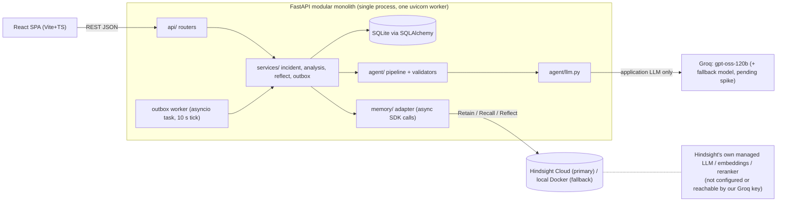

# Greeting

## Assistant

_[Claude used prepare_session]_

## Human

continue

[attachment: Hindsight API verification pending--6ddd003a.zip]

## Assistant

I'll start by unpacking the attached archive to see where things were left.

_[Claude used Bash]_

_[Claude used Bash]_

_[Claude used Bash]_

_[Claude used Bash]_

_[Claude used Bash]_

_[Claude used Bash]_

_[Claude used Bash]_

_[Claude used Bash]_

_[Claude used TaskCreate]_

_[Claude used TaskCreate]_

_[Claude used TaskCreate]_

_[Claude used TaskCreate]_

_[Claude used TaskUpdate]_

_[Claude used WebFetch]_

_[Claude used WebFetch]_

_[Claude used WebFetch]_

_[Claude used WebFetch]_

_[Claude used WebFetch]_

_[Claude used WebFetch]_

_[Claude used WebFetch]_

_[Claude used WebSearch]_

_[Claude used WebFetch]_

_[Claude used WebFetch]_

_[Claude used WebFetch]_

_[Claude used WebSearch]_

_[Claude used WebFetch]_

_[Claude used WebFetch]_

_[Claude used WebFetch]_

_[Claude used WebFetch]_

_[Claude used WebFetch]_

_[Claude used WebFetch]_

Still working: I've checked the official Hindsight docs and SDK source. Cloud's models are managed, so I'll drop the Groq arrow. I also found the smoke script calls `alist_memories(document_id=…)`, which the SDK doesn't accept, so I'll fix it. Now rewriting the five unfinished docs.

_[Claude used WebFetch]_

_[Claude used WebFetch]_

_[Claude used WebFetch]_

_[Claude used WebFetch]_

_[Claude used Bash]_

**Claude created `hindsight_smoke.py`**

```python
"""
SRMA Hindsight Cloud smoke test (owner: H2 + Claude-H).      STATUS: NOT RUN against Cloud when this file was written.

Run (on a machine with network access to Hindsight Cloud):
    pip install hindsight-client==1.2.0
    HINDSIGHT_BASE_URL=https://api.hindsight.vectorize.io HINDSIGHT_API_KEY=... python spike/hindsight_smoke.py
Offline harness check (no network, proves only that this script's logic runs):
    python spike/hindsight_smoke.py --selftest
Also run first (offline, 2 min): python spike/inspect_sdk.py   -> signatures of the *installed* SDK.

Safety: only touches banks named srma-spike-*; never calls any delete/clear method.
Output: spike/results/<timestamp>.json. Paste verbatim into docs/hindsight-spike-results.md; do NOT edit by hand.
Step ids L1..L12 + L14 match hindsight-integration.md section 10 (L13 = credit cost, read manually from the dashboard).
Everything recorded is OBSERVED behaviour of the installed SDK + live service; nothing here is an assumption.
"""
import asyncio, json, os, sys, time, uuid, traceback
from datetime import datetime, timezone
from types import SimpleNamespace

NARR_001 = """INCIDENT INC-001 - Intermittent DB connection timeouts in payment-service
Date: 2026-08-12 | Service: payment-service | Severity: SEV2 | Status: resolved
Symptoms: intermittent 30s timeouts acquiring DB connections; began ~2h after release 3.8.0.
Error messages: HikariPool-1 - Connection is not available, request timed out after 30000ms
Investigation steps: (1) DB CPU and slow-query check: ruled out. (2) Increased app pool 10->30: INEFFECTIVE, recurred in 6h. (3) Pod restart: temporary relief only.
Root cause (CONFIRMED, cause_key=commons-db-2.3.0-retry-leak): svc-commons-db 2.3.0 retry path leaks one connection per timeout.
Resolution (EFFECTIVE, verified): upgrade svc-commons-db to 2.3.1.
Record revision: 1"""
NARR_001_APPEND = "Addendum: INC-001 follow-up - audit showed inventory and auth services were also on 2.3.0.\nRecord revision: 2"
NARR_002 = NARR_001.replace("INC-001", "INC-002").replace("payment-service", "inventory-sync-worker")
NARR_TS = "INCIDENT INC-TS - timestamp-type probe. Service: probe-service. Root cause (CONFIRMED): none, probe only.\nRecord revision: 1"
Q_REL = "connection pool timeouts after release"
Q_UNREL = "kafka consumer lag after partition rebalance"
Q_SIG = "Connection is not available, request timed out"


def now(): return time.perf_counter()


def dump(o):
    if hasattr(o, "model_dump"):
        try: return o.model_dump(mode="json")
        except Exception: pass
    return repr(o)


def hit_row(h):
    sc = getattr(h, "scores", None)
    return {"id": getattr(h, "id", None), "type": getattr(h, "type", None), "document_id": getattr(h, "document_id", None),
            "chunk_id": getattr(h, "chunk_id", None), "metadata": getattr(h, "metadata", None), "tags": getattr(h, "tags", None),
            "source_fact_ids": getattr(h, "source_fact_ids", None), "scores": dump(sc) if sc is not None else None,
            "mentioned_at": str(getattr(h, "mentioned_at", None)), "text": (getattr(h, "text", "") or "")[:220]}


async def timed(label, coro, out):
    t = now()
    try:
        r = await coro
        out[label] = {"ok": True, "latency_s": round(now() - t, 3), "result": dump(r)}
        return r
    except Exception as e:  # record exception type/status faithfully (needed to design adapter error mapping)
        out[label] = {"ok": False, "latency_s": round(now() - t, 3), "exc_type": type(e).__name__,
                      "exc_module": type(e).__module__, "status": getattr(e, "status", None),
                      "body": str(getattr(e, "body", None) or e)[:500]}
        return None


async def op_status(client, bank, op):
    api = client.operations
    try:
        return await api.get_operation_status(bank_id=bank, operation_id=op)
    except TypeError:                                   # docs example is positional; keep both forms
        return await api.get_operation_status(bank, op)


async def run(client, bank, empty_bank, out):
    out["meta"] = {"started": datetime.now(timezone.utc).isoformat(), "bank": bank, "python": sys.version.split()[0]}
    try:
        import importlib.metadata as md
        out["meta"]["sdk_version"] = md.version("hindsight-client")
    except Exception as e:
        out["meta"]["sdk_version"] = f"unknown ({type(e).__name__})"
    # L1 auth + version
    await timed("L1_version", client.aget_version(), out)
    # L2 bank creation with missions; error type of acreate_bank is recorded (source suggests aiohttp, not ApiException)
    await timed("L2_create_bank", client.acreate_bank(bank_id=bank,
        reflect_mission="You analyse resolved production incidents. Prefer evidence over speculation; distinguish confirmed from suspected causes; cite incident IDs.",
        retain_mission="Extract incident facts: service, symptoms, error messages, failed fixes, root cause (note confirmed vs suspected), resolution and outcome. Always keep incident IDs (INC-###) in every fact."), out)
    await timed("L2b_create_bank_again_same_id", client.acreate_bank(bank_id=bank), out)          # idempotent? conflict?
    await timed("L2c_recall_nonexistent_bank", client.arecall(bank_id=f"{bank}-never-created", query="x"), out)  # auto-create or error?
    # L3 sync retain: latency, response shape, datetime timestamp
    meta = {"incident_id": "INC-001", "service": "payment-service", "root_cause_status": "confirmed", "revision": "1"}
    await timed("L3_retain_sync", client.aretain(bank_id=bank, content=NARR_001, context="resolved production incident record",
        timestamp=datetime(2026, 8, 12, 10, 0, tzinfo=timezone.utc), document_id="INC-001", metadata=meta, tags=["incident:INC-001"], update_mode="replace"), out)
    await timed("L3b_retain_timestamp_as_iso_string", client.aretain(bank_id=bank, content=NARR_TS, timestamp="2026-08-12T10:00:00Z",
        document_id="INC-TS", metadata={"incident_id": "INC-TS"}), out)   # does the SDK accept str despite the datetime annotation?
    # L5 immediate recallability after the sync retain returned (poll until first hit, cap 90 s)
    t0, hits, polls = now(), None, []
    while now() - t0 < 90:
        r = await client.arecall(bank_id=bank, query=Q_REL, max_tokens=2048)
        polls.append({"t": round(now() - t0, 2), "n": len(r.results)})
        if r.results: hits = r; break
        await asyncio.sleep(2)
    out["L5_recallability"] = {"polls": polls, "first_hit_after_s": polls[-1]["t"] if hits else None}
    # L4 provenance fields on every hit (+ tag-filter probe)
    if hits:
        out["L4_provenance"] = [hit_row(h) for h in hits.results]
    await timed("L4b_recall_tag_filter_any_strict", client.arecall(bank_id=bank, query=Q_REL, tags=["incident:INC-001"], tags_match="any_strict"), out)
    # L7 duplicate document_id behaviour (counts via list_memories(document_id=...) -> .total)
    async def count():
        l = await client.alist_memories(bank_id=bank, document_id="INC-001", limit=100); return l.total
    out["L7_counts"] = {"after_first_retain": await count()}
    await timed("L7_retain_replace_same_content", client.aretain(bank_id=bank, content=NARR_001, document_id="INC-001", update_mode="replace", metadata=meta), out)
    out["L7_counts"]["after_replace_same_content"] = await count()
    await timed("L7_retain_append", client.aretain(bank_id=bank, content=NARR_001_APPEND, document_id="INC-001", update_mode="append", metadata=meta), out)
    out["L7_counts"]["after_append"] = await count()
    # L7b: replace with CHANGED content (a root-cause correction). Are the old facts gone from recall?
    rev = NARR_001.replace("svc-commons-db 2.3.0 retry path leaks one connection per timeout.",
        "REVISED: PgBouncer default_pool_size too small (supersedes earlier retry-leak theory).").replace("Record revision: 1", "Record revision: 3")
    await timed("L7b_retain_replace_changed", client.aretain(bank_id=bank, content=rev, document_id="INC-001", update_mode="replace", metadata=meta), out)
    rr = await client.arecall(bank_id=bank, query="svc-commons-db retry path leaks one connection per timeout", max_tokens=2048)
    out["L7b_stale_check"] = {"count_after": await count(), "hits": [hit_row(h) for h in rr.results]}
    # L8 async retain + operation_id idempotency + status polling
    op = str(uuid.uuid4())
    await timed("L8_retain_async_1", client.aretain(bank_id=bank, content=NARR_002, document_id="INC-002", retain_async=True, operation_id=op,
                metadata={"incident_id": "INC-002"}), out)
    await timed("L8_retain_async_dup_same_operation_id", client.aretain(bank_id=bank, content=NARR_002, document_id="INC-002", retain_async=True, operation_id=op,
                metadata={"incident_id": "INC-002"}), out)
    t0, status_log = now(), []
    while now() - t0 < 120:
        try:
            s = await op_status(client, bank, op)
            status_log.append({"t": round(now() - t0, 1), "status": getattr(s, "status", repr(s))})
            if status_log[-1]["status"] in ("completed", "failed", "cancelled"): break
        except Exception as e:
            status_log.append({"t": round(now() - t0, 1), "exc": type(e).__name__, "status": getattr(e, "status", None)}); break
        await asyncio.sleep(3)
    out["L8_operation_polling"] = status_log
    # L5b consolidation (observations) timing
    t0, cons = now(), []
    while now() - t0 < 90:
        l = await client.alist_memories(bank_id=bank, limit=100)
        p = await client.alist_memories(bank_id=bank, consolidation_state="pending", limit=1)
        o = await client.alist_memories(bank_id=bank, type="observation", limit=1)
        cons.append({"t": round(now() - t0, 1), "total": l.total, "pending_consolidation": p.total, "observations": o.total})
        if p.total == 0: break
        await asyncio.sleep(5)
    out["L5b_consolidation"] = cons
    # L6 one document -> many hits? observation attribution via source facts
    r6 = await client.arecall(bank_id=bank, query="database connection exhaustion across services", max_tokens=4096, include_source_facts=True)
    per_doc = {}
    for h in r6.results: per_doc[getattr(h, "document_id", None)] = per_doc.get(getattr(h, "document_id", None), 0) + 1
    sf = getattr(r6, "source_facts", None)
    out["L6_multi_hit"] = {"hits_per_document_id": per_doc, "n_hits": len(r6.results), "hits": [hit_row(h) for h in r6.results],
                           "source_facts_type": type(sf).__name__, "source_facts_sample": dump(sf)[:1500] if sf is not None else None}
    # L12 score semantics: same SDK, relevant vs unrelated vs error-signature queries
    sc = {}
    for name, q in (("relevant", Q_REL), ("unrelated", Q_UNREL), ("signature", Q_SIG)):
        r = await client.arecall(bank_id=bank, query=q, max_tokens=2048)
        sc[name] = [hit_row(h)["scores"] for h in r.results[:5]]
    out["L12_scores"] = sc
    # L14 extraction fidelity: what facts did Hindsight actually keep? (read by a human)
    lm = await client.alist_memories(bank_id=bank, limit=100)
    out["L14_extracted_facts"] = [dump(m) for m in getattr(lm, "items", [])][:60]
    # L9 reflect: free text + structured_output + based_on
    schema = {"type": "object", "properties": {"patterns": {"type": "array", "items": {"type": "object", "properties": {
        "title": {"type": "string"}, "statement": {"type": "string"},
        "supporting_incident_ids": {"type": "array", "items": {"type": "string"}},
        "confidence": {"type": "string", "enum": ["low", "medium", "high"]}}, "required": ["title", "statement", "supporting_incident_ids"]}}},
        "required": ["patterns"]}
    q = "Across all resolved incidents, what failure patterns recur across different services? List incident IDs, ineffective fixes and what to check first. Distinguish confirmed from suspected causes."
    await timed("L9_reflect_structured_with_facts", client.areflect(bank_id=bank, query=q, budget="mid", include_facts=True, response_schema=schema), out)
    await timed("L9b_reflect_plain_low_budget", client.areflect(bank_id=bank, query=q), out)   # latency/determinism comparison
    # L10 empty (existing) bank behaviour
    await timed("L10_create_empty_bank", client.acreate_bank(bank_id=empty_bank), out)
    await timed("L10_recall_empty_bank", client.arecall(bank_id=empty_bank, query="connection timeouts"), out)
    await timed("L10_reflect_empty_bank", client.areflect(bank_id=empty_bank, query=q), out)
    # L11 error shapes: bad key (402/429 cannot be provoked safely; read them from the dashboard/logs if they occur)
    base = os.environ.get("HINDSIGHT_BASE_URL", "https://api.hindsight.vectorize.io")
    bad = type(client)(base_url=base, api_key="invalid-key", max_attempts=1) if not isinstance(client, SimpleNamespace) else client
    await timed("L11_bad_api_key_recall", bad.arecall(bank_id=bank, query="x"), out)
    out["meta"]["finished"] = datetime.now(timezone.utc).isoformat()
    out["meta"]["manual_step_L13"] = "Record credit balance in the Cloud dashboard before and after this run; divide by operation counts."


class FakeClient(SimpleNamespace):
    """selftest only: proves the harness logic runs; says NOTHING about Hindsight."""
    async def _m(self, **k):
        h = SimpleNamespace(id="m1", type="world", text="t" * 5, document_id="INC-001", metadata={}, tags=[], scores=None,
                            model_dump=lambda mode=None: {})
        return SimpleNamespace(model_dump=lambda mode=None: {"fake": True}, results=[h], items=[], total=0, status="completed", source_facts=None)
    def __getattr__(self, n):
        if n.startswith("a"): return self._m
        raise AttributeError(n)


async def main():
    selftest = "--selftest" in sys.argv
    stamp = datetime.now(timezone.utc).strftime("%Y%m%d-%H%M%S")
    bank, empty = f"srma-spike-{stamp}", f"srma-spike-{stamp}-empty"
    assert bank.startswith("srma-spike-") and empty.startswith("srma-spike-")
    if selftest:
        client = FakeClient(operations=SimpleNamespace(get_operation_status=lambda **k: asyncio.sleep(0, SimpleNamespace(status="completed"))))
    else:
        from hindsight_client import Hindsight
        client = Hindsight(base_url=os.environ["HINDSIGHT_BASE_URL"], api_key=os.environ["HINDSIGHT_API_KEY"], timeout=120.0)
    out = {}
    try: await run(client, bank, empty, out)
    except Exception: out["harness_error"] = traceback.format_exc()
    finally:
        if not selftest: await client.aclose()
    os.makedirs("spike/results", exist_ok=True)
    path = f"spike/results/{'SELFTEST-' if selftest else ''}{stamp}.json"
    json.dump(out, open(path, "w"), indent=2, default=str)
    print("wrote", path, "| harness_error:", "harness_error" in out)

if __name__ == "__main__": asyncio.run(main())

```

**Claude created `inspect_sdk.py`**

```python
"""
Offline SDK inspection (no network, no key).  Run AFTER `pip install hindsight-client==1.2.0`.
Prints the real signatures of the installed SDK so hindsight-integration.md section 3 can be checked
against what is actually installed (docs and GitHub `main` can differ from a released version).
    python spike/inspect_sdk.py > spike/results/sdk_signatures.txt
"""
import importlib.metadata as md, inspect, sys

try:
    print("hindsight-client", md.version("hindsight-client"), "| python", sys.version.split()[0])
except md.PackageNotFoundError:
    sys.exit("hindsight-client is not installed")

from hindsight_client import Hindsight

NAMES = ["aretain", "arecall", "areflect", "acreate_bank", "aget_version", "alist_memories", "aclose",
         "adelete_bank", "aget_bank_config", "aupdate_bank_config", "retain", "recall", "reflect"]
print("\n== Hindsight.__init__", inspect.signature(Hindsight.__init__))
for n in NAMES:
    f = getattr(Hindsight, n, None)
    print(f"\n== {n}:", inspect.signature(f) if f else "NOT PRESENT")
    if f is not None and inspect.iscoroutinefunction(f): print("   (coroutine function)")

print("\n== namespaces on an instance (no network used)")
c = Hindsight(base_url="http://localhost:1", api_key="x")
for ns in ("memory", "documents", "operations", "banks"):
    o = getattr(c, ns, None)
    print(f"{ns}:", type(o).__name__, [m for m in dir(o) if not m.startswith("_") and "with_http_info" not in m and "without_preload" not in m][:40] if o else None)

print("\n== response model fields")
for mod, cls in (("hindsight_client_api.models.recall_result", "RecallResult"), ("hindsight_client_api.models.recall_response", "RecallResponse"),
                 ("hindsight_client_api.models.reflect_response", "ReflectResponse"), ("hindsight_client_api.models.retain_response", "RetainResponse"),
                 ("hindsight_client_api.models.list_memory_units_response", "ListMemoryUnitsResponse")):
    try:
        m = __import__(mod, fromlist=[cls]); k = getattr(m, cls)
        print(cls, list(k.model_fields.keys()))
    except Exception as e:
        print(cls, "NOT INSPECTED:", type(e).__name__, e)

try:
    from hindsight_client_api.exceptions import ApiException
    print("\nApiException attrs:", [a for a in ("status", "reason", "body", "data", "headers") if a in inspect.signature(ApiException.__init__).parameters or hasattr(ApiException, a)])
except Exception as e:
    print("ApiException NOT INSPECTED:", e)

```

**Claude created `groq_smoke.py`**

```python
"""
SRMA Groq smoke test (owner: H4 + Claude-I).  STATUS: NOT RUN when written.
Answers, with real calls: is each configured model listed for THIS key; does it honour a strict JSON schema; latency.
    pip install openai   # OpenAI-compatible client
    GROQ_API_KEY=... python spike/groq_smoke.py openai/gpt-oss-120b openai/gpt-oss-20b qwen/qwen3-32b
This is the APPLICATION's LLM. It does not configure Hindsight's internal model (managed on Cloud).
"""
import json, os, sys, time
from openai import OpenAI

c = OpenAI(api_key=os.environ["GROQ_API_KEY"], base_url=os.environ.get("LLM_BASE_URL", "https://api.groq.com/openai/v1"))
listed = {m.id for m in c.models.list().data}
schema = {"name": "ping", "strict": True, "schema": {"type": "object", "additionalProperties": False,
          "properties": {"service": {"type": "string"}, "severity": {"type": "string", "enum": ["SEV1", "SEV2", "SEV3", "SEV4"]}},
          "required": ["service", "severity"]}}
res = {}
for model in sys.argv[1:] or ["openai/gpt-oss-120b"]:
    r = {"listed_for_key": model in listed}
    for mode in ("json_schema_strict", "json_object"):
        t = time.perf_counter()
        try:
            rf = {"type": "json_schema", "json_schema": schema} if mode == "json_schema_strict" else {"type": "json_object"}
            out = c.chat.completions.create(model=model, temperature=0.2, response_format=rf, messages=[
                {"role": "user", "content": "Return JSON {service, severity} for: checkout-service outage, customers cannot pay, SEV2."}])
            txt = out.choices[0].message.content
            json.loads(txt)
            r[mode] = {"ok": True, "latency_s": round(time.perf_counter() - t, 2), "sample": txt[:120]}
        except Exception as e:
            r[mode] = {"ok": False, "exc": type(e).__name__, "msg": str(e)[:200]}
    res[model] = r
print(json.dumps(res, indent=2))

```

_[Claude used Bash]_

_[Claude used Bash]_

_[Claude used TaskUpdate]_

_[Claude used TaskUpdate]_

Research and the spike scripts are done. I've checked the smoke script's offline selftest (it only proves the harness logic runs, not anything about Hindsight). Now writing `hindsight-integration.md` and `api-contracts.md`, then architecture, demo plan and implementation plan.

**Claude created `hindsight-integration.md`**

```markdown
# hindsight-integration.md  (v2.0 — documentation- and SDK-checked; live verification NOT RUN)

> ## STATUS: Task 2 is **NOT complete**
> Everything below is tagged with its evidence tier. **No live Hindsight Cloud call has been executed by the architect** (no key or network in the authoring environment). The live smoke test (`spike/hindsight_smoke.py`) has **not been run**; §10 and §11 are intentionally empty until the Hindsight owner (H2) pastes real output. Nothing in this file may be marked "verified" before that.
>
> | Tier | Tag | Meaning | Status |
> |---|---|---|---|
> | Documented | **[D]** | Stated on the official docs, read 2026-11-06 (links in §12) | filled in below |
> | SDK-inspected | **[S]** | Read in `hindsight-client` source at GitHub tag `v1.2.0` (via page fetch; the file was too long to read completely). **Not yet confirmed against the installed package** — run `python spike/inspect_sdk.py` first | filled in below |
> | Live-verified | **[L]** | Observed by running the smoke script against Cloud | **NONE — NOT RUN** |
> | Assumption | **[A]** | Our design decision or guess; must be confirmed by [D]/[S]/[L] or an organiser | listed in §10/§13 |
>
> Rule for all code and docs: only the tag [L] may be described as "verified". [D] and [S] are "documented" / "per SDK source".

## 1. Selected SDK and deployment
| Item | Value | Tier |
|---|---|---|
| Package / import | `pip install hindsight-client` → `from hindsight_client import Hindsight` | [D] |
| **Selected version** | **`hindsight-client==1.2.0`** (latest on PyPI, released 2026-11-03; `requires-python >=3.10`; deps include `pydantic>=2`, `aiohttp>=3.8.4`, `urllib3<3`) | [D] PyPI + [S] `pyproject.toml` at tag v1.2.0. **Installed version to be recorded from `pip show` by H2; freeze it in the lockfile and do not upgrade after the smoke test passes.** The release is 3 days old; the docs we read are for the `main`/latest site and may describe newer behaviour — hence `inspect_sdk.py`. |
| Cloud base URL | `https://api.hindsight.vectorize.io` | [D] |
| Auth | `Authorization: Bearer <api key>`; SDK `Hindsight(base_url=..., api_key=...)` | [D] |
| Constructor | `Hindsight(base_url, api_key=None, timeout=300.0, user_agent=None, max_attempts=3)`; `max_attempts` applies **only to idempotent calls (recall, reflect)**; retries only on HTTP 429/503 with `Retry-After`/jittered backoff; **retain is never retried by the SDK** | [S] |
| Python | 3.11 (satisfies `>=3.10`) | [A] choice, constraint [D] |
| Cloud vs local | Cloud primary; local Docker (`hindsight-all`/server image) fallback — local requires its own LLM key (§3) | [D] |
| Billing | prepaid credits, 1 credit = $1; retain $10/M input tokens, recall $0.75/M output tokens, reflect $0.05/call (rates effective 2026-07-06); HTTP **402** when balance is exhausted. The promo `MEMHACK99` ($50, from the organiser PDF) is **not mentioned in the billing docs** — H2 confirms in the dashboard | [D]; promo = organiser info, unconfirmed |

## 2. Which model does Hindsight use? (correction of the earlier diagram)
- **Hindsight Cloud: the LLM, embedding and reranking models are "included"/managed by the service. The docs we read do not describe any way to choose the Cloud model or to bring our own LLM key.** [D]
- **Self-hosted Hindsight** is configured by server env vars `HINDSIGHT_API_LLM_PROVIDER` (default `openai`; `groq` is a supported value), `HINDSIGHT_API_LLM_MODEL` (default `gpt-5-mini`), `HINDSIGHT_API_LLM_API_KEY`, `HINDSIGHT_API_LLM_BASE_URL`. [D] These do not apply to Cloud.
- **Therefore: our application's Groq key (`GROQ_API_KEY`) configures only the application's own analysis LLM. It does not configure, and is never used by, Hindsight's extraction/consolidation/reflect model.** The architecture diagram no longer draws a Hindsight→Groq edge.
- Consequence we accept: Hindsight's extraction quality and Reflect style are outside our control on Cloud. Mitigation: `retain_mission` / `reflect_mission` + disposition (§5, §7), L14 extraction-fidelity check, and deterministic app-side validation of Reflect output (architecture §6).
- Open item [A→docs]: ask Vectorize (or read the Cloud docs) whether a Cloud model can be configured. Not blocking.

## 3. API surface we use [S] (parameters exactly as in the v1.2.0 source; all async-first)
All FastAPI code paths use the **`a*` coroutine methods only**. The sync wrappers run an internal event loop and are documented to fail inside a running loop [S] — **never call sync methods from a request handler**. One `Hindsight` instance per process, created in the app lifespan and closed with `await client.aclose()`.

| Purpose | Async method | Parameters we pass (others left default) | Returns |
|---|---|---|---|
| Version/health | `aget_version()` | — | `VersionResponse` (`api_version`, `features`) [D] |
| Create bank | `acreate_bank(bank_id, name=None, mission=None, retain_mission=None, reflect_mission=None, disposition_*=None, …)` | `bank_id`, `retain_mission`, `reflect_mission`, `disposition_skepticism` | `BankProfileResponse`. **Implemented with raw aiohttp: on HTTP error it raises `aiohttp.ClientResponseError`, not `ApiException`** [S] |
| Retain | `aretain(bank_id, content, timestamp=None, context=None, document_id=None, metadata=None, entities=None, resolve_entities=None, tags=None, update_mode=None, retain_async=False, operation_id=None, observation_scopes=…, strategy=…)` | `bank_id, content, timestamp(datetime), context, document_id, metadata, tags, update_mode="replace"` | `RetainResponse` (`success`, `bank_id`, `items_count`, `async`/`var_async`; `usage` for sync) [S]/[D] |
| Recall | `arecall(bank_id, query, types=None, max_tokens=4096, budget="mid", trace=False, query_timestamp=None, include_entities=False, include_chunks=False, include_source_facts=False, max_source_facts_tokens=4096, tags=None, tags_match="any", prefer_observations=False, min_scores=None, temporal_window=None, …)` | `bank_id, query, budget, max_tokens, include_source_facts=True` (to attribute observations — see §6) | `RecallResponse` |
| Reflect | `areflect(bank_id, query, budget="low", context=None, max_tokens=None, response_schema=None, tags=None, tags_match="any", include_facts=False, include_tool_calls=False, …)` | `bank_id, query, budget, response_schema, include_facts=True` | `ReflectResponse` |
| List memories (spike/verify only) | `alist_memories(bank_id, type=None, search_query=None, …, limit=100, offset=0, document_id=…, consolidation_state=…)` | for spike/`verify-seed` | `ListMemoryUnitsResponse` (`total`, …) |
| Close | `aclose()` | — | — |
| Op status (only if async retain is adopted) | `client.operations.get_operation_status(bank_id, operation_id)`; statuses `pending, processing, completed, failed, cancelled` | | [D] |

**Not used by app code (enforced by CI grep, data-model §6):** any `*delete*`, `*clear*`, `reset_*` method. `adelete_bank`/`delete_bank` exist in the SDK [S]; whether **Cloud** permits bank deletion is **not stated in the docs we read** [D: silent]. App never calls them; the answer does not affect the design.

**Parameter semantics [D]:**
- `retain.content` is the only required field; Hindsight **stores extracted facts, not the original text**.
- `retain.timestamp`: ISO-8601 string (REST), omitted = now, `"unset"` = none. The Python annotation is `datetime`; whether a `str` is accepted by the SDK is **unclear [S] → L3b**. We pass a `datetime`.
- `retain.metadata`: string→string; values returned with recalled memories; `null` values dropped. `tags` are *visibility* tags: a memory is returned in a tag-filtered recall only if its tags intersect the filter. `context` is injected into the extraction prompt.
- `retain.document_id` makes retain idempotent: **reusing it upserts — the old document and all its memories are deleted, then the new content is processed** (`update_mode="replace"`, the default). `"append"` concatenates onto the existing document and reprocesses it. Items without `document_id` are never folded into another document. Deleting a document also deletes the observations built from its facts [D]. *Live behaviour = L7.*
- `retain_async=True` returns immediately with an `operation_id`; same `operation_id` again creates no new work; reusing it for a different operation → HTTP 409; no `usage` is returned for async [D].
- `recall`: `types` ⊆ {`world`,`experience`,`observation`}; `budget` low/mid/high; `max_tokens` caps fact text only; queries **> 500 tokens are rejected** (keep our queries short); `query_timestamp` anchors relative dates; a query that matched something is never returned empty by the token cap [D].
- **Recall result fields [D]:** `id`, `text`, `type`, `context`, `metadata`, `tags`, `entities`, `occurred_start/end`, `mentioned_at`, **`document_id`**, `chunk_id`, **`source_fact_ids`** (observations only), **`scores{final, reranker, semantic, keyword}`**. Response-level: `results`, `source_facts` (dict keyed by fact id, when requested), `chunks`, `entities`, `trace`.
- **Score semantics [D]:** `final` is the ranking score (results sorted by it, descending); `reranker`/`semantic` are 0–1 or `null`; `keyword` is BM25 or `null`; **"scores are relative to a single query and are not comparable across queries"**. ⇒ The app uses **rank order only** — no absolute thresholds, no cross-query comparison (§6).
- **Reflect [D]:** `query` (situational context belongs inside the query text); `budget` low (default)/mid/high; `response_schema` adds `structured_output` next to `text` (`text` is always returned; `structured_output_error` appears if schema extraction failed but the call still returns 200); `include.facts` → `based_on{memories, mental_models, directives}` = sources actually retrieved in the loop ("citations are validated to prevent hallucinated references"); `usage`; optional `trace`. The SDK spells the flag `include_facts=True` [S].
- **Errors [D]:** 400, 401 (invalid/expired key), 402 (insufficient credits), 403, 404, 500. Error-body structure is not documented → L11. **SDK exceptions [S]:** `hindsight_client_api.exceptions.ApiException` (has `.status`, `.body`) for API calls; `aiohttp.ClientResponseError` from `acreate_bank`; `TimeoutError`/`RuntimeError` in export helpers; `ValueError` for bad `min_scores` keys; `warnings.warn` if `operation_id` is passed without `retain_async`. The adapter therefore catches `Exception` and classifies (§4).
- Banks: the docs state a bank is **auto-created with default settings on first use** [D]; mission/disposition are set by `create_bank`/`update_bank_config`. `reflect_mission` and disposition **affect only reflect** [D]. Whether `acreate_bank` on an existing id is idempotent, and whether `arecall` on a never-created bank errors or auto-creates → **L2/L2b/L2c**.
- Default SDK timeout is **300 s** [S]; we always wrap calls in `asyncio.wait_for` with our own limits (§4).

## 4. Adapter module — the only code that imports `hindsight_client`
`backend/app/memory/` (WS-H). Nothing else imports `hindsight_client`, `hindsight_client_api` or `aiohttp` for Hindsight (CI grep). Interfaces are in api-contracts.md "Python seam interfaces"; this section is the behavioural contract.

| Rule | Detail |
|---|---|
| Never raises | Every public method returns a typed result (`ok`/`error` + `AdapterError`). `asyncio.CancelledError` is re-raised; all other exceptions are caught and classified. |
| Normalisation | SDK models → our Pydantic models immediately; no SDK type, attribute name or field crosses the module boundary. Missing/`None` fields tolerated; unknown fields ignored; wrong types → `malformed_response`. |
| Timeouts | recall 8 s (all queries run concurrently with `asyncio.gather`; one query failing does not discard the others), retain 60 s [A, tune by L3], reflect 60 s [A, tune by L9]; SDK `timeout=` set to the same upper bound and `max_attempts=2`. |
| Retries | **No retries inside the adapter for retain** (the outbox owns retry; SDK doesn't retry writes). Recall/reflect: SDK handles 429/503 only; adapter adds none. |
| Fake | `FakeMemoryService` (keyword-overlap over `data/fixtures/*.json`) implements the identical Protocol with fault injection `MEMORY_FAULT=none|down|slow|malformed|empty|no_provenance|multi_incident`. `main` must always boot and pass tests with `MEMORY_BACKEND=fake`. |
| Bank guard | adapter is constructed with one `bank_id`; refuses to operate (`bank_mismatch`) when it differs from `app_meta.bank_id`. Bank id must match `^srma-(demo|dev|eval|spike)-[a-z0-9-]+$`. |
| Logging | each call → `memory_events` row (op, status, latency, error_kind). API keys and full content are never logged (content hash + length only). |

**Error classification (adapter → `error_kind`, `retryable`):**
| Condition | `error_kind` | outbox class |
|---|---|---|
| `asyncio.TimeoutError`, connection reset/DNS | `timeout` | transient |
| HTTP 429 | `rate_limited` | transient |
| HTTP 5xx | `server` | transient |
| HTTP 401/403 | `auth` | permanent |
| HTTP 402 | `insufficient_credits` | permanent (engineer retries after top-up) |
| HTTP 400/404/409/422 | `bad_request` | permanent |
| result fields missing / wrong type / not parseable | `malformed_response` | permanent |
| bank id ≠ `app_meta.bank_id` | `bank_mismatch` | permanent (worker does not claim rows) |
| anything else | `unexpected` | unexpected → `failed` |

## 5. Memory content (what is retained, and its formats)
Trigger: only an engineer-confirmed resolve (outbox row `kind=resolution`) or a correction (`kind=correction`). Never open incidents, never agent output, never analysis text.

**Narrative** (one plain-text document per incident revision; content is frozen into the outbox row at enqueue):
```
INCIDENT INC-001 - Intermittent DB connection timeouts in payment-service
Date: 2026-08-12 | Service: payment-service | Severity: SEV2 | Status: resolved
Symptoms: ...
Error messages: HikariPool-1 - Connection is not available, request timed out after 30000ms
Conditions: began ~2h after release 3.8.0 which bumped svc-commons-db 2.2.4 -> 2.3.0
Investigation steps: (1) DB CPU/slow queries: ruled out. (2) pool 10->30: INEFFECTIVE, recurred in 6h. (3) restart: temporary relief only.
Root cause (CONFIRMED, cause_key=commons-db-2.3.0-retry-leak): ...
Resolution (EFFECTIVE, verified): ...
Lessons learned: ...
Record revision: 1
```
Rules: first line starts with the incident ID so every extracted fact can carry it; suspected causes are written `Root cause (SUSPECTED, unverified)`; raw logs truncated to key lines; ≤ ~4,000 chars.

**Call:** `aretain(bank_id=BANK, content=<narrative>, context="resolved production incident record", timestamp=<resolved_at as datetime>, document_id="INC-001", metadata={"incident_id":"INC-001","service":"payment-service","root_cause_status":"confirmed","revision":"1"}, tags=["incident:INC-001","service:payment-service"], update_mode="replace")` — synchronous retain (response carries `usage`/`items_count`; "ok" means processed). `HINDSIGHT_RETAIN_MODE=sync` default. **Only if L3 shows sync latency too high** switch to `async` (`retain_async=True, operation_id=<outbox.id>`; adapter polls `operations.get_operation_status`); the outbox state machine is unchanged. Metadata values are strings only.

**Bank configuration (set once by CLI `demo-new`/`dev-new` via `ensure_bank`, [A] wording, tune after L14):**
- `retain_mission`: "Extract incident facts: service, symptoms, error messages, failed fixes, root cause (note confirmed vs suspected), resolution and outcome. Always keep the incident ID (INC-###) in every fact."
- `reflect_mission`: "You analyse resolved production incidents. Prefer evidence over speculation; distinguish confirmed from suspected causes; cite incident IDs; never state a cause as confirmed unless the incident record says CONFIRMED."
- Disposition: `skepticism=4, literalism=4, empathy=2` [A; D says it only affects reflect].
One bank per environment; no per-service banks (cross-service patterns are the point).

## 6. Recall workflow, provenance, consolidation
Three concurrent queries per analysis (each < 500 tokens): (1) **narrative** (symptoms + service + conditions in natural language), (2) **error signature** (normalised error strings, digits stripped), (3) **failed-fix** ("fixes tried and ineffective for <symptom class>"). `types=None` (all), `budget="mid"`, `max_tokens=4096`, `include_source_facts=True`.

**Provenance resolution per hit (adapter; in this order; first match wins):**
1. `hit.document_id` matching `^INC-\d{3}$` → `provenance="document_id"` [D: field exists; **L4: is it populated?**]
2. `hit.metadata["incident_id"]` matching the pattern → `"metadata"`
3. a tag `incident:INC-###` → `"tag"`
4. observation hits (no single document): look up `source_fact_ids` in `response.source_facts` and resolve each fact's `document_id` → `"source_facts"` [shape of `source_facts` items unverified → **L6**]
5. regex `\bINC-\d{3}\b` over `text`: exactly one distinct ID → `"text_regex"`; **two or more distinct IDs → `cross_incident`** (snippet attached to the *set* of IDs, flagged `multi`); none → unattributed.

**Rules for what the application does with hits:**
- **Not one-to-one.** One retained document yields many extracted facts [D: `memory_unit_count`], so several hits can belong to one incident, and one observation can mention several incidents.
- **Dedup:** drop repeats across the three queries by `hit.id`; then by normalised text.
- **Consolidate to candidates:** group by incident ID; per incident keep `best_rank` (lowest rank position in the query where it ranked best), up to 3 distinct snippets, `hit_count`, `memory_types`, `provenance` (weakest used). **`related_incidents` are built from candidates, never from hits.**
- **Malformed ID** (e.g. `INC-12`, `INC-1234`, `inc 001`): counted in `RecallResult.invalid_refs`, never auto-corrected, never a candidate.
- **Well-formed but not in SQLite, or in SQLite but `status=open`** (open incidents are never retained, so this signals corruption/bank mix-up): dropped; counted in `RecallResult.unknown_refs`; shown in Memory Trace as "memory references unknown incident INC-099 (ignored)".
- **Unattributed hits:** kept in the trace only; **never passed to the analysis LLM as incident evidence**.
- **Scores:** per-hit `rank` (1-based) is the only value used for logic; raw `scores.*` are displayed in the Memory Trace labelled "relative to this query" [D]. `RecallResult.status="empty"` when zero attributable candidates remain *and* zero hits (hits exist but none attributable → `ok` with a warning, `candidates=[]`).
- **Enrichment** (services/): candidate → SQLite incident record (status, root cause + status, steps, outcome). Root cause shown as "confirmed" only from SQLite (architecture §6).
- **Staleness:** narratives carry `Record revision: N`; adapter parses it when present; if DB revision > memory revision, the candidate is flagged `superseded_memory=true` (data-model §4).

## 7. Reflect workflow
Manual, on demand (`POST /api/reflect`); **no auto-refresh after resolve** (reasons in architecture §5: unknown latency, non-blocking resolve, avoids presenting stale text as new). The last successful result is stored with its timestamp (`reflections`).

Fixed default question (repeatable demo): "Across all resolved incidents: what failure patterns recur across different services? For each pattern give the supporting incident IDs, which fixes were repeatedly ineffective, which were effective, and what engineers should check first on a new incident of this kind. Say explicitly which root causes are confirmed and which are only suspected."

Call: `areflect(bank_id, query, budget="mid", include_facts=True, response_schema=PATTERN_SCHEMA)` with `PATTERN_SCHEMA = {patterns:[{title, statement, supporting_incident_ids:[str], confidence: low|medium|high}]}`. `budget`/timeout pending L9. Adapter returns `ReflectRaw{text, structured, structured_error, based_on, usage, latency_ms}`. Validation, grounding rules and the UI contract are in architecture §6 and api-contracts `ReflectResult`. **Reflect output is untrusted generated text** — it is never used to change SQLite, and is rendered without HTML.
Why Reflect ≠ recall: see demo-plan §4. If L9 shows the output is generic, the seed data and `reflect_mission` are tuned; we do **not** post-edit Reflect text.
Empty-bank rule: the application does **not** call Reflect when SQLite has zero resolved incidents (`status="empty"`); L10 records what Hindsight does anyway.

## 8. Outbox interplay (summary; canonical lifecycle in data-model §3)
Adapter `retain()` returns `ok|error`+`error_kind`; it never knows the words `pending/synced/failed`. The outbox worker (`services/outbox.py`) owns all state transitions. `document_id` = incident ID makes a crash-after-accept retry an idempotent upsert **[D; confirm L7]** ⇒ at-least-once delivery, no duplicate memories.

## 9. Banks and reset safety (summary; canonical rules in data-model §6)
- Bank IDs: demo `srma-demo-YYYYMMDD-NN` (versioned, never reused), dev `srma-dev-<name>[-NN]`, eval `srma-eval-<runid>`, spike `srma-spike-<stamp>`. `DEMO_MODE=true` requires a `srma-demo-*` bank; `DEMO_MODE=false` forbids it (a developer cannot touch the demo bank by accident).
- **No HTTP endpoint and no app code deletes or clears a bank, a document or memories.** "Reset" = CLI `demo-new` / `dev-new`: new SQLite file + new bank id; the old SQLite file is renamed into `data/archive/`, the old bank is left untouched (a human may delete it in the Cloud console). **Nothing is deleted from SQLite or Hindsight by any reset.**
- The spike script only touches `srma-spike-*` banks and never calls a delete method.

## 10. Live verification register (every row is **NOT RUN** until H2 pastes output)
Run order: `pip install hindsight-client==1.2.0` → `python spike/inspect_sdk.py` → `python spike/hindsight_smoke.py` (writes `spike/results/<ts>.json`). Fill the last column **only** from that JSON; copy snippets into `docs/hindsight-spike-results.md`.

| ID | Question | Script step | Blocks | Result |
|---|---|---|---|---|
| L1 | Auth works; `get_version` response; installed SDK version | `L1_version`, `meta.sdk_version` | adapter | NOT RUN |
| L2 | `acreate_bank` works with missions; error type; idempotent on existing id?; `arecall` on a never-created bank: error or auto-create? | `L2*` | `ensure_bank`, CLI | NOT RUN |
| L3 | Sync retain latency, `RetainResponse` fields, `usage`; does `timestamp` accept an ISO string (L3b)? | `L3*` | retain timeout, sync vs async | NOT RUN |
| L4 | Are `document_id`, `metadata`, `tags`, `scores.*`, `mentioned_at` populated on recall hits? Does `tags_match="any_strict"` filter as documented? | `L4*` | provenance order (§6) | NOT RUN |
| L5 | Time from retain return to first recall hit; time until observations consolidate | `L5`, `L5b` | live-retain demo, T-test timing | NOT RUN |
| L6 | Hits per document; do observation hits carry `source_fact_ids`; shape of `source_facts` items (has `document_id`?) | `L6_multi_hit` | rule 4 in §6 | NOT RUN |
| L7 | Duplicate `document_id`: counts after replace / append; **after replace with changed content, are old facts and observations gone from recall?** | `L7*` | idempotent retry, correction flow | NOT RUN |
| L8 | Async retain + same `operation_id` twice; status polling; time to `completed` | `L8*` | only if async mode adopted | NOT RUN |
| L9 | Reflect: shape, `structured_output`, `based_on` content, whether incident IDs appear, latency at budget low/mid, run-to-run variance | `L9*` | reflect timeout, validation design | NOT RUN |
| L10 | Recall/Reflect on an existing empty bank | `L10*` | empty-state rules | NOT RUN |
| L11 | Error shape for bad key (exception type/status/body); 402/429 only if encountered | `L11*` | error classification table (§4) | NOT RUN |
| L12 | Score behaviour: relevant vs unrelated vs signature queries (are scores query-relative as documented?) | `L12_scores` | confirms rank-only rule | NOT RUN |
| L13 | Credit cost per retain/recall/reflect (dashboard balance before/after); promo applied? | manual | budget | NOT RUN |
| L14 | **Extraction fidelity:** do extracted facts keep the incident ID, failed fixes, confirmed-vs-suspected, versions? (human reads `L14_extracted_facts`) | `L14` | retain narrative/mission tuning | NOT RUN |

**Task 2 is complete only when:** (a) `inspect_sdk.py` output is pasted and §3 reconciled with it; (b) every L-row above has a real result or an explicit "not supported / failed" note; (c) §11 is filled from real responses; (d) the contracts in api-contracts.md are corrected for any difference found. Until then the adapter is built against the Protocol + fake, and `MEMORY_BACKEND=fake` remains the default in CI.

## 11. Verified request/response examples
*Intentionally empty. To be pasted verbatim from `spike/results/<ts>.json`. No example may be written by hand.*

## 12. Sources read (2026-11-06)
Docs: hindsight.vectorize.io — Python SDK page; Retain, Recall, Reflect, Memory banks, Documents, Operations API pages; Hindsight Cloud page; models page; configuration page; docs.hindsight.vectorize.io — api-integration, billing. Source: `vectorize-io/hindsight` `hindsight-clients/python/hindsight_client/hindsight_client.py` and `pyproject.toml` at tag `v1.2.0` (partial read) and `main`. PyPI `hindsight-client`. **Discrepancy noted:** the `main`-branch read listed fewer `alist_memories`/`aretain` parameters than the v1.2.0 tag; this is why the *installed* package must be inspected (`inspect_sdk.py`) before the adapter is finalised.

## 13. Unverified assumptions specific to Hindsight (see implementation-plan §8 for the full register)
Installed SDK = 1.2.0 and matches §3 · `timestamp` as `datetime` is accepted · `document_id`/`metadata`/`tags` are returned on hits · observation attribution via `source_facts` works · `replace` removes stale facts *and* observations · sync retain latency acceptable (< ~30 s) · reflect latency acceptable at `budget="mid"` · Cloud bank creation/config via SDK works with our key · promo credit applied · Cloud model not configurable.

```

**Claude created `api-contracts.md`**

```markdown
# api-contracts.md  (v1.0-rc — FREEZE at G1, Fri Nov 6 18:00 IST; afterwards changes only by PR approved by H1)

Base: `/api`, JSON, UTF-8, no auth. Canonical models: `backend/app/contracts.py` (Pydantic v2). This document mirrors them; OpenAPI (`/openapi.json`) is generated; the frontend generates `frontend/src/api/types.ts` with `openapi-typescript`. If this file and `contracts.py` disagree, `contracts.py` wins and this file is fixed in the same PR.

**Hindsight-facing parts (adapter interface, `error_kind`, provenance) are written from documentation and SDK source only (hindsight-integration.md tiers [D]/[S]). They are *contract-frozen* now so other workstreams can build against the fake, and are corrected after the live spike if it shows a difference (that is the only allowed post-freeze change to them, via PR).**

## Enums
`Severity`: SEV1|SEV2|SEV3|SEV4 · `IncidentStatus`: open|resolved · `RootCauseStatus`: confirmed|suspected|ruled_out|superseded (resolve accepts only confirmed|suspected) · `Outcome`: effective|partial|ineffective · `StepOutcome`: tried|effective|partial|ineffective|ruled_out · `Relevance`: strong|partial|weak|unrelated · `Label`: OBSERVED|HISTORICAL|INFERRED|TO_VERIFY · `MemoryStatus`: ok|empty|unavailable|disabled · `RetainStatus` (**derived, API-only, never stored**): pending|synced|failed|not_applicable · `OutboxStatus` (**stored, the only four**): pending|in_progress|succeeded|failed · `OutboxKind`: resolution|correction · `ReflectFreshness`: fresh|stale|none · `Provenance`: document_id|metadata|tag|source_facts|text_regex · `ErrorKind`: timeout|rate_limited|auth|insufficient_credits|server|bad_request|malformed_response|bank_mismatch|unexpected
`Category` (controlled, shared by steps and recommendations — identical to data-model §2): `increase_pool_size, increase_db_capacity, adjust_proxy_pool, restart, check_library_version, upgrade_dependency, check_connection_leak, check_slow_queries, check_db_capacity, check_recent_deploy, check_config, rollback, other`

## Error envelope (all non-2xx)
```json
{"error": {"code": "VALIDATION_ERROR", "message": "Human readable", "details": [{"field": "description", "issue": "min length 10"}]}}
```
Codes: `VALIDATION_ERROR`(422) · `NOT_FOUND`(404) · `CONFLICT`(409) · `LLM_UNAVAILABLE`(503) · `INTERNAL`(500). **Hindsight problems are never errors** on analyze/resolve/reflect (degraded 200 with explicit state, see below); retention problems surface through `retain_status`/`outbox`.

## Endpoints (13)
| # | Method & path | Purpose | Success |
|---|---|---|---|
| 1 | `GET /api/health` | liveness + dependencies | 200 `Health` |
| 2 | `GET /api/services` | dropdown | 200 `{items:[{name, description}]}` |
| 3 | `POST /api/incidents` | create | 201 `Incident` |
| 4 | `GET /api/incidents?status=&service=&limit=50&offset=0` | list, newest first | 200 `{items: Incident[], total}` |
| 5 | `GET /api/incidents/{id}` | detail | 200 `IncidentDetail` |
| 6 | `POST /api/incidents/{id}/analyze` | run agent | 200 `AnalysisReport` |
| 7 | `GET /api/analyses/{analysis_id}` | stored report | 200 `AnalysisReport` |
| 8 | `POST /api/incidents/{id}/resolve` | persist resolution + enqueue retention | 200 `IncidentDetail` |
| 9 | `POST /api/incidents/{id}/retain` | retry a failed retention | 200 `RetainRetryResult` |
| 10 | `POST /api/reflect` | generate a new reflection (manual) | 200 `ReflectResult` |
| 11 | `GET /api/reflection` | last successful reflection + freshness (never calls Hindsight) | 200 `ReflectResult` |
| 12 | `GET /api/memory/events?limit=50&incident_id=` | Memory Trace history (append-only) | 200 `{items: MemoryEvent[]}` |
| 13 | `GET /api/memory/outbox?status=&incident_id=` | Memory Trace current retention state | 200 `{items: OutboxItem[]}` |

**Removed from HTTP (was #12/#13 in v0.1): `POST /api/demo/seed` and `POST /api/demo/reset`.** Seeding and resetting are guarded CLI commands (below); no HTTP endpoint can delete or wipe anything.

### Health (#1)
`{status:"ok|degraded", db:"ok|down", hindsight:"ok|down|unconfigured|bank_mismatch", llm:"ok|down|unconfigured", memory_backend:"fake|hindsight", llm_backend:"fake|groq", bank_id:"srma-demo-…"|null, bank_mode:"demo|dev|eval|null", outbox:{pending:int, in_progress:int, failed:int}, version:"git sha"}`. The health check calls `aget_version()` with a 3 s timeout and is cached 10 s.

## Schemas
### CreateIncidentRequest (#3)
```json
{
  "title": "Checkout 503s in bursts after release",          // 5-200 chars, required
  "description": "Free text ...",                              // 10-5000, required
  "service": "checkout-service",                               // slug ^[a-z0-9-]{2,60}$, auto-creates service
  "severity": "SEV2",                                          // required
  "error_messages": ["java.sql.SQLTransientConnectionException ..."], // optional, <=20 items, each <=1000
  "evidence": "pasted logs / metrics notes",                   // optional, <=20000 chars
  "metadata": {"region": "eu-west-1", "release": "1.14.0"},    // optional, <=20 keys, str->str; MAY be incomplete (e.g. no library version)
  "occurred_at": "2026-11-05T14:20:00Z"                        // optional ISO-8601, default now
}
```
### Incident
`{id:"INC-009", title, description, service, severity, status, error_messages[], evidence, metadata{}, occurred_at, created_at, resolved_at|null, revision:int, retain_status}`
### IncidentDetail
`Incident & {investigation_steps:[{seq, action, category, outcome, notes|null}], root_cause:{description, status, cause_key|null, revision}|null, resolution:{actions_taken, outcome, verified}|null, lessons_learned|null, latest_analysis_id|null, outbox: OutboxItem|null}` — `outbox` is the latest row (highest revision, then `created_at`) and is the sole source of `retain_status`.

### Retain status — one definition, one code path
`retain_status` is computed by a single repository function `derive_retain_status(incident_id)` used by **every** serializer, from the latest outbox row: none → `not_applicable` · `pending`/`in_progress` → `pending` · `succeeded` → `synced` · `failed` → `failed`. It is never stored and never set by hand, so API and DB cannot disagree (test: `test_retain_status_matches_outbox`). State transitions and their owners are in data-model §3 and are not repeated here.

### AnalyzeRequest (#6) / AnalysisReport (#6, #7)
Request: `{"use_memory": true}` (default true). `false` ⇒ `memory.status="disabled"`, recall step skipped, **everything else identical** (same prompts, model, temperature).
```json
{
  "analysis_id": "ana_01H...", "incident_id": "INC-009", "mode": "memory_on", "created_at": "...",
  "model": "openai/gpt-oss-120b",
  "memory": {"status": "ok", "reason": null, "queries": ["..."], "hits_count": 12, "candidates_count": 5,
             "unattributed_count": 1, "unknown_refs": [], "invalid_refs": [], "latency_ms": 940},
  "incident_summary": {"services": ["checkout-service"], "symptoms": ["..."], "error_signatures": ["..."], "conditions": ["release 1.14.0"]},
  "missing_information": ["Version of the shared DB client library (svc-commons-db)", "Postgres active connections by application"],
  "related_incidents": [{
    "incident_id": "INC-001", "title": "...", "retrieval_rank": 1, "provenance": "document_id",
    "relevance": "strong", "why_relevant": "...", "matching_features": ["..."], "differences": ["..."],
    "historical_root_cause": {"text": "...", "status": "confirmed", "cause_key": "commons-db-2.3.0-retry-leak", "source": "db"},
    "past_attempts": [{"action": "Increased pool size 10->30", "category": "increase_pool_size", "outcome": "ineffective"}],
    "past_resolution": {"text": "...", "outcome": "effective", "source": "db"},
    "superseded_memory": false,
    "evidence": [{"memory_id": "mem_x|null", "memory_type": "experience|world|observation|null", "snippet": "...", "provenance": "document_id"}]
  }],
  "findings": [{"statement": "...", "label": "OBSERVED", "evidence_refs": ["incident:INC-009"]}],
  "recommended_steps": [{
    "order": 1, "action": "...", "rationale": "...", "category": "check_library_version",
    "label": "TO_VERIFY", "evidence_refs": ["INC-001","INC-002"],
    "previously_failed_refs": [], "risk_note": "read-only check"
  }],
  "validation_actions": [{"rule": "unknown_incident_id_stripped", "detail": "INC-099"}],
  "warnings": ["Historical match is not proof of the same cause."],
  "disclaimer": "Advisory only. Engineer must verify before acting."
}
```
**Fields computed by the application, never trusted from the LLM:** `historical_root_cause.*`, `past_attempts`, `past_resolution`, `title`, `provenance`, `retrieval_rank`, `superseded_memory`, `recommended_steps[].previously_failed_refs` (= IDs of related incidents with relevance ≥ partial that have a step of the same `category` with outcome `ineffective|partial|ruled_out`), and `memory.*`. The LLM supplies only `relevance`, `why_relevant`, `matching_features`, `differences`, findings, steps, `missing_information`.

**Evidence-label rules (enforced by `agent/validators.py`; violations are repaired and listed in `validation_actions`, never silently):**
1. `OBSERVED` — only facts from the *current* incident's own submitted data; `evidence_refs ⊆ ["incident:<current id>"]`.
2. `HISTORICAL` — facts about past incidents; each ref must be a candidate ID that exists in SQLite as `resolved`; **forbidden when `memory.status != ok`**.
3. `INFERRED` — reasoning from observed + historical facts; needs ≥1 ref.
4. `TO_VERIFY` — hypotheses and every action that needs confirmation. A claim about the cause of the *open* incident can never be `OBSERVED` or `HISTORICAL`; it is forced to `INFERRED`/`TO_VERIFY`. Recommended steps are only `INFERRED` or `TO_VERIFY`.
5. Missing/invalid label → downgraded to `TO_VERIFY` (rule `label_defaulted`). Unknown/open/malformed incident ID → removed from refs (rule `unknown_incident_id_stripped`); a finding left with no refs that required one is dropped (rule `unsupported_finding_dropped`).
6. A `historical_root_cause.status` shown to users is the SQLite value; if LLM text calls a suspected cause "confirmed" the sentence is flagged (rule `suspected_rendered_as_confirmed`) and replaced with the DB status.
7. `suspected`/`confirmed` language about a historical cause appears only in `historical_root_cause`; free-text must say "recorded as suspected" for `suspected`.

**Memory states:** `ok` (≥1 attributable candidate) · `empty` (recall succeeded, nothing attributable → `related_incidents=[]`, UI "No relevant historical memory found") · `unavailable` (`reason`: `timeout|rate_limited|auth|insufficient_credits|server|bad_request|malformed_response|bank_mismatch|unexpected`; banner "analysis without historical memory") · `disabled` (use_memory=false). When `memory.status != ok`: `related_incidents` MUST be `[]` and no finding may be `HISTORICAL`.

### ResolveRequest (#8) — 409 if already resolved
```json
{
  "root_cause": {"description": "...", "status": "confirmed", "cause_key": "commons-db-2.3.0-retry-leak"},   // cause_key optional, ^[a-z0-9][a-z0-9.-]{2,80}$; used only to verify cross-incident claims
  "resolution": {"actions_taken": "...", "outcome": "effective", "verified": true},
  "investigation_steps": [{"action": "...", "category": "increase_pool_size", "outcome": "ineffective", "notes": "..."}],
  "lessons_learned": "..."
}
```
Behaviour: one SQLite transaction writes resolution, root cause, steps, sets `status=resolved`, builds the retention narrative, and inserts the outbox row `pending` (data-model §3). The transaction **cannot be rolled back by Hindsight** because Hindsight is not called inside it. After commit the handler calls `outbox.kick()` (non-blocking) and returns. **The response always has `retain_status="pending"`** (never `synced`, never waits for Hindsight); the UI polls `GET /incidents/{id}` every 2 s until `synced` or `failed`. A Hindsight outage therefore never blocks, delays or fails a resolve.

### Retain retry (#9) → `RetainRetryResult`
`{retain_status, outbox: OutboxItem|null, action: "requeued"|"noop_already_synced"}`. Rules (data-model §3): latest row `failed` → same row back to `pending`, `attempts=0` (never a second row; UNIQUE(incident_id, kind, revision)); latest row `succeeded` → 200 `noop_already_synced`; latest `pending|in_progress` → 409 `CONFLICT`; incident not resolved → 409; unknown incident → 404.

### OutboxItem (#13, embedded in IncidentDetail)
`{id, incident_id, kind, revision, status: OutboxStatus, attempts, max_attempts, next_attempt_at|null, last_error_kind: ErrorKind|null, last_error|null, created_at, completed_at|null}`

### Reflect (#10, #11) — see architecture §6 for the validation algorithm
`POST /api/reflect` body `{"question": null}` (null ⇒ fixed default question; custom question allowed but stored). **Manual only** — no automatic refresh after resolve. Single flight: a second call while one is running → 409 `CONFLICT`. If SQLite has 0 resolved incidents the app does **not** call Hindsight and returns `status="empty"`. `GET /api/reflection` returns the stored last success (or `freshness="none"`) without calling Hindsight.
```json
{
  "status": "ok|unavailable|empty",
  "freshness": "fresh|stale|none",
  "stale_reason": "new_incidents_resolved|last_attempt_failed|null",
  "generated_at": "ISO|null", "resolved_count_at_generation": 8, "current_resolved_count": 9,
  "last_attempt": {"at": "ISO", "status": "ok|error", "error_kind": "timeout|null"},
  "question": "...", "latency_ms": 31000,
  "patterns": [{
    "pattern_id": "p1", "title": "Same library defect behind connection exhaustion in 3 services",
    "interpretation": "text written by Hindsight Reflect (generated)", "label": "INFERRED",
    "grounding": "db_verified_shared_cause|db_supported|unsupported",
    "shared_cause_key": "commons-db-2.3.0-retry-leak|null",
    "supporting_incidents": [{"incident_id": "INC-001", "title": "...", "service": "...",
        "root_cause": {"text": "...", "status": "confirmed", "cause_key": "..."}, "outcome": "effective", "source": "db"}],
    "flags": ["INC-008 described as confirmed by Reflect; record says suspected"]
  }],
  "narrative_markdown": "sanitised Hindsight text (untrusted, collapsed by default)",
  "grounding_summary": {"patterns_total": 3, "patterns_shown": 2, "patterns_suppressed": 1, "invalid_refs": ["INC-12"], "unknown_refs": ["INC-099"]},
  "warnings": ["..."]
}
```
`freshness`: `none` = nothing stored; `fresh` = latest stored generation covers all currently resolved incidents *and* the last attempt succeeded; `stale` otherwise (`stale_reason` says why). A stale result is always rendered with its timestamp and a "generated from N of M resolved incidents" notice, never as a new insight. The raw Hindsight response (text, structured output, `based_on`) is stored in `reflections` for traceability and is available only via `GET /api/reflection?include_raw=true` (rendered as escaped plain text in the Memory Trace).

### MemoryEvent (#12)
`{id, ts, op: retain|recall|reflect, status: pending|ok|empty|error, latency_ms|null, incident_id|null, outbox_id|null, attempt|null, error_kind|null, summary, error|null}` — append-only history. **The current state of a retention is `OutboxItem.status` (#13), never inferred from events.** The Memory Trace shows, per retention: the outbox row's current status (pending / in_progress / succeeded / failed + attempts + next attempt time) with its attempt events beneath.

## Validation summary
Trim whitespace; reject control characters; reject empty strings; enforce limits above; `evidence` truncated server-side to 6,000 chars for prompts (full text stored); unknown fields rejected (`extra=forbid`). Reflect/Hindsight text is never interpreted as HTML.

## Python seam interfaces (frozen; Protocols in `contracts.py`/`memory/base.py`)
```python
# ---- memory seam (WS-H implements; WS-B consumes). No SDK types appear here. ----
class AdapterError(BaseModel):  kind: ErrorKind; retryable: bool; message: str  # sanitised, no secrets; http_status: int | None
class RetainRequest(BaseModel): incident_id: str; revision: int; document_id: str; content: str; timestamp: datetime
                                context: str; metadata: dict[str, str]; tags: list[str]
class RetainResult(BaseModel):  status: Literal["ok", "error"]; items_count: int | None; usage_tokens: int | None
                                latency_ms: int; operation_id: str | None; error: AdapterError | None
class MemoryHit(BaseModel):     hit_id: str | None; text: str; memory_type: Literal["world","experience","observation"] | None
                                document_id: str | None; source_incident_ids: list[str]   # [] = unattributed; >1 = cross-incident
                                provenance: Provenance | None; record_revision: int | None; rank: int
                                scores: dict[str, float | None]   # display only: final/reranker/semantic/keyword, query-relative
class Candidate(BaseModel):     incident_id: str; best_rank: int; hit_count: int; snippets: list[MemoryHit]  # <=3, distinct
                                provenance: Provenance; multi: bool
class RecallResult(BaseModel):  status: Literal["ok", "empty", "unavailable"]; queries: list[str]; hits: list[MemoryHit]
                                candidates: list[Candidate]; unattributed_count: int; invalid_refs: list[str]; unknown_refs: list[str]
                                latency_ms: int; error: AdapterError | None   # unknown_refs filled by services/ after the DB check
class ReflectRaw(BaseModel):    status: Literal["ok", "error"]; text: str | None; structured: dict | None; structured_error: str | None
                                based_on: list[dict] | None; usage_tokens: int | None; latency_ms: int; error: AdapterError | None
class HealthResult(BaseModel):  status: Literal["ok", "down", "unconfigured", "bank_mismatch"]; detail: str | None

class MemoryService(Protocol):
    bank_id: str
    async def retain(self, req: RetainRequest) -> RetainResult                                   # never raises
    async def recall_for_incident(self, incident: Incident, extraction: Extraction) -> RecallResult   # never raises; dedup + consolidation inside
    async def reflect(self, question: str) -> ReflectRaw                                         # never raises
    async def health(self) -> HealthResult
    async def ensure_bank(self, retain_mission: str, reflect_mission: str) -> None               # CLI only; create-if-absent, never deletes
# NOTE: there is deliberately no delete/clear/reset method on this Protocol.

# ---- agent seam (WS-I) ----
class AgentService(Protocol):
    async def extract(self, incident: Incident) -> Extraction
    async def analyse(self, incident: Incident, extraction: Extraction, candidates: list[EnrichedCandidate]) -> AnalysisDraft
# EnrichedCandidate {candidate: Candidate, incident: IncidentDetail}   # services/ builds it; only DB-resolved incidents reach the agent
# AnalysisDraft = LLM-owned fields only; services/ merges app-computed fields (see AnalysisReport) and runs validators.
```
`retain_status` vocabulary (`pending|synced|failed|not_applicable`) exists **only** in the API layer; adapter vocabulary is `ok|error`; outbox vocabulary is `pending|in_progress|succeeded|failed`. No component may use another component's words.

## CLI commands (guarded; `python -m srma.cli <cmd>`, wrapped by `make`)
| Command | Does | Never does |
|---|---|---|
| `bank-info` | prints bank id/mode, `app_meta`, health | writes |
| `seed` | loads `data/seed_incidents.json` through the normal resolve path (SQLite + outbox), then `drain-outbox`; idempotent (re-seed = same `document_id` upsert, no duplicates [D; L7]). Refuses if `HINDSIGHT_BANK_ID` ≠ `app_meta.bank_id` or the bank/mode pairing is illegal | deletes anything |
| `drain-outbox [--timeout 300]` | runs the worker until no `pending/in_progress` rows remain | |
| `verify-seed` | for each seeded incident, recall its title and assert ≥1 attributable candidate (acceptance A1) | |
| `demo-new --date YYYYMMDD --nn NN` | **requires `DEMO_MODE=true`**; creates `data/demo/srma-demo-YYYYMMDD-NN.sqlite`, a **new** bank `srma-demo-YYYYMMDD-NN` via `ensure_bank`, writes `app_meta`; refuses if that bank id was used before | delete/clear any SQLite file or bank |
| `dev-new --name <n>` | same for `srma-dev-<n>-NN` with `DEMO_MODE=false` | idem |
| `archive-db` | renames the current SQLite file into `data/archive/<ts>-<name>.sqlite` | deletes |
**Exactly what any "reset" deletes: nothing** — in SQLite (old file archived by rename) and in Hindsight (old bank untouched). A human may delete old banks in the Cloud console. Rule enforced by CI grep for `delete|clear|reset_bank` outside `spike/` (data-model §6).

## Configuration (single source: `backend/app/config.py`; `.env.example` mirrors this table)
| Variable | Default | Notes |
|---|---|---|
| `MEMORY_BACKEND` | `fake` | `fake|hindsight` |
| `LLM_BACKEND` | `fake` | `fake|groq` |
| `MEMORY_FAULT`, `LLM_FAULT` | `none` | fake backends only: `down|slow|malformed|empty|no_provenance|multi_incident` / `invalid_json|timeout|rate_limit` |
| `HINDSIGHT_BASE_URL` | `https://api.hindsight.vectorize.io` | [D] |
| `HINDSIGHT_API_KEY` | — | secret, backend only |
| `HINDSIGHT_BANK_ID` | — | must match `^srma-(demo|dev|eval|spike)-[a-z0-9-]+$` |
| `HINDSIGHT_RETAIN_MODE` | `sync` | `sync|async` (async only if L3 requires) |
| `HINDSIGHT_RECALL_TIMEOUT_S` / `_RETAIN_TIMEOUT_S` / `_REFLECT_TIMEOUT_S` | `8` / `60` / `60` | [A]; tune after L3, L9 |
| `HINDSIGHT_REFLECT_BUDGET` | `mid` | `low|mid|high` [D] |
| `GROQ_API_KEY` | — | secret. **Application LLM only; does not configure Hindsight** |
| `LLM_BASE_URL` | `https://api.groq.com/openai/v1` | OpenAI-compatible |
| `LLM_MODEL` | `openai/gpt-oss-120b` | listed Production on Groq 2026-11-06 [D] |
| `LLM_FALLBACK_MODEL` | *unset until `spike/groq_smoke.py` is run* | organiser guide names `qwen/qwen3-32b`, which is **not on Groq's current models page**; candidate `openai/gpt-oss-20b` (strict JSON-schema listed) |
| `LLM_TEMPERATURE` | `0.2` | fixed for A/B and evals |
| `DEMO_MODE` | `false` | only enables the guarded `demo-new` CLI; nothing destructive exists |
| `SRMA_DB_PATH` | `data/dev/srma-dev.sqlite` | |
| `OUTBOX_TICK_S` / `OUTBOX_LEASE_S` / `OUTBOX_MAX_ATTEMPTS` | `10` / `180` / `5` | match data-model §3 |
| `FRONTEND_ORIGIN` | `http://localhost:5173` | CORS |

```

**Claude created `architecture.md`**

```markdown
# architecture.md  (v1.1)

## 1. Principles
1. **Hindsight finds candidates; the app DB verifies them.** Hindsight provides associative recall and synthesis. SQLite is the source of truth for incident status, root-cause confirmation, outcomes and what has been retained. The agent may only cite incidents that exist in SQLite as `resolved`.
2. **Contract first.** `backend/app/contracts.py` (Pydantic v2) is canonical; frontend types are generated from OpenAPI.
3. **One seam per external system.** Only `app/memory/` imports the Hindsight SDK; only `app/agent/llm.py` imports the LLM client. Both have `fake` implementations (with fault injection) so every workstream runs before real services are ready. **Two different LLMs exist and must not be confused:** the *application* LLM (Groq, configured by `GROQ_API_KEY`/`LLM_MODEL`) and *Hindsight's internal* extraction/reflect model (managed by Hindsight Cloud; not configurable by us — hindsight-integration §2).
4. **No framework tax.** Plain functions for the pipeline; no agent framework; no tool calling (organiser warns about function-calling errors) — JSON-schema responses validated by Pydantic with one repair retry.
5. **Advisory, evidence-labelled output.** Every claim carries `OBSERVED|HISTORICAL|INFERRED|TO_VERIFY`; recommendations never claim certainty.
6. **Retention can never block or lose a resolution.** Resolve commits to SQLite first; Hindsight is reached later through a SQLite outbox.

## 2. High-level architecture

There is **no arrow from Hindsight to Groq**: on Cloud, Hindsight's models are managed and no BYO-key path is documented; on self-hosted Hindsight the server has its own `HINDSIGHT_API_LLM_*` configuration which is separate from our app settings.

## 3. Component responsibilities
| Component | Owns | Must not |
|---|---|---|
| `api/` | HTTP, validation, error mapping, envelope | business logic |
| `services/` | orchestration, transactions, enrichment (candidate → DB incident), outbox worker, reflect validation, derived `retain_status` | call SDKs directly |
| `db/` | models, repo functions, seed loader | know about Hindsight |
| `memory/` | adapter: retain/recall/reflect, query construction, narrative templating, hit normalisation + provenance + dedup/consolidation, timeouts, error classification; `FakeMemoryService` | leak SDK types; touch SQLite or the outbox; delete/clear anything |
| `agent/` | extraction + analysis prompts, schema validation, repair retry, label validators | touch DB or Hindsight |
| `frontend/` | UI only; typed API client; safe Markdown rendering | hold secrets; render raw HTML |

## 4. Analysis flow — `POST /api/incidents/{id}/analyze`
```mermaid
sequenceDiagram
  participant UI
  participant S as AnalysisService
  participant A as Agent
  participant M as MemoryAdapter
  participant H as Hindsight
  participant D as SQLite
  UI->>S: analyze(id, use_memory)
  S->>A: extract(incident)  [LLM call 1: symptoms, entities, error signatures, missing info]
  alt use_memory
    S->>M: recall_for_incident(incident, extraction)
    M->>H: arecall x3 concurrently (narrative, error signature, failed-fix)
    H-->>M: hits
    M-->>S: RecallResult(status ok|empty|unavailable, candidates, invalid_refs)
    S->>D: verify candidate IDs exist & resolved; enrich with record, root cause+status, steps, outcome
  end
  S->>A: analyse(incident, extraction, enriched candidates)  [LLM call 2: AnalysisDraft]
  S->>S: merge app-computed fields from DB; run validators (api-contracts "Evidence-label rules")
  S->>D: persist analysis + memory_events
  S-->>UI: AnalysisReport
```
**Memory-OFF = identical pipeline with only the recall step skipped** (same model, prompts, temperature, incident). The A/B is therefore controlled; its measured outcome is reported as measured (demo-plan §6), never assumed.

## 5. Memory lifecycle
| Event | Action | Notes |
|---|---|---|
| Incident submitted / analysed | **No retain.** | Unverified hypotheses and agent text must not become "memory". |
| Engineer resolves incident | SQLite commit **+ outbox row `pending` in the same transaction**; worker retains one narrative (`document_id = INC-###`) | Resolve returns immediately with `retain_status="pending"`. |
| Root cause corrected later (UI is P1) | SQLite: new root-cause row, old `superseded`, `revision+1`; outbox row `kind=correction`; full corrected narrative re-retained with same `document_id`, `update_mode="replace"` | data-model §4. Until it succeeds, recalled snippets for that incident carry the "corrected after this memory was recorded" badge. |
| Engineer feedback on a recommendation (P1) | retain short note | |
| Analysis report text | **Never retained.** | |
| New analysis | **Recall** (3 queries) | |
| Pattern view | **Reflect — manual button only** | see below |

**Resolve + retain flow (canonical lifecycle in data-model §3):**
```mermaid
sequenceDiagram
  participant UI
  participant R as incident_service.resolve
  participant D as SQLite
  participant W as outbox worker
  participant M as MemoryAdapter
  UI->>R: POST resolve
  R->>D: BEGIN; save resolution+steps+root cause; incident=resolved; INSERT outbox(pending, frozen narrative); COMMIT
  R-->>UI: 200 IncidentDetail (retain_status=pending)
  R-)W: kick()
  W->>D: claim: pending→in_progress (compare-and-set)
  W->>M: retain(narrative, document_id)
  alt ok
    W->>D: in_progress→succeeded   (retain_status=synced)
  else transient error and attempts<5
    W->>D: in_progress→pending, next_attempt_at=backoff
  else permanent / attempts exhausted
    W->>D: in_progress→failed      (retain_status=failed; engineer can retry)
  end
```
Process death: before the first attempt → row is still `pending` and is picked up at next boot/tick; mid-attempt → lease expiry (180 s) returns it to `pending`; after Hindsight accepted but before `succeeded` → the retry re-sends the same `document_id`, which upserts (no duplicate) [D; confirm L7]. Delivery is at-least-once with idempotent upsert. `retain_status` is *derived* from the outbox on every read, so the API can never contradict the DB, and the Memory Trace renders pending/succeeded/failed from outbox rows (events are history only).

**Why Reflect is manual (decision, replaces "auto-refresh after each resolve"):** Reflect latency and cost are unmeasured (L9; billed per call); an automatic call after each resolve would either block resolve or race several concurrent generations; and an out-of-date automatic result would look like a fresh insight. Instead: the last successful reflection is stored with `generated_at` and the count of resolved incidents it covered; `GET /api/reflection` returns it with `freshness` (`fresh|stale|none`); the Patterns page shows "generated at … from N of M resolved incidents — refresh" and a failed refresh leaves the previous result visible, marked stale with `last_attempt` details. Reflect failure, timeout or 402 never affects incident resolution.

## 6. Evidence integrity and grounding validation
### 6.1 Recall candidates (preventing false historical associations)
1. Recall returns *hits*; the adapter normalises, deduplicates and consolidates them into *candidates* per incident (hindsight-integration §6). A hit is **not** an incident and a candidate is **not** a conclusion.
2. `services/` accepts a candidate only if its ID matches `^INC-\d{3}$`, exists in SQLite and is `resolved`; others are dropped and counted (`invalid_refs`, `unknown_refs`).
3. The LLM rates each candidate `strong|partial|weak|unrelated` and lists matching features **and differences**.
4. Root cause, outcomes, attempts and resolution shown to users come from SQLite (`source:"db"`). Memory snippets are labelled "memory snippet" and are never the source of a "confirmed" statement.
5. If no candidate is ≥ partial → UI shows "No relevant historical memory found" — never invented history.
6. Prompt rule: similar symptoms ≠ same cause; always include a TO_VERIFY step "what would distinguish them"; if key metadata is absent (e.g. library version) list it first in `missing_information` and do **not** assert the historical cause for the new incident.

### 6.2 Analysis validator (`agent/validators.py` + `services/`)
Applies the label rules in api-contracts ("Evidence-label rules 1–7"): refs ⊆ DB-verified candidates; HISTORICAL forbidden unless `memory.status=ok`; suspected causes never rendered as confirmed; unlabelled → `TO_VERIFY`; every repair is recorded in `validation_actions` (and checked by T-tests).

### 6.3 Reflect grounding validation (`services/reflect_service.py`)
Reflect text is **untrusted generated interpretation**. A valid incident ID does not make a claim about that incident true, so validity of IDs is only step 2 of 8:
1. **Request** `areflect(..., include_facts=True, response_schema=PATTERN_SCHEMA)`. Use `structured_output.patterns[]` when present; if `structured_output` is absent or `structured_output_error` is set, fall back to `text` with one "unstructured" pattern whose IDs come from the regex `\bINC-\d{3}\b` over that text. (Regex is the fallback, not the primary path.)
2. **Extract + validate IDs** per pattern: exact `^INC-\d{3}$` only; near-misses (`INC-12`, `INC-1234`) → `invalid_refs` (not auto-corrected); well-formed but not in SQLite or not `resolved` → `unknown_refs`. Dropped IDs are listed in `grounding_summary` and `warnings`.
3. **Fetch authoritative records** for the remaining IDs.
4. **Never accept Reflect's claims about root causes/resolutions.** The UI's root-cause/outcome fields come only from SQLite. Reflect's `statement` is shown as `interpretation`, always labelled `INFERRED`.
5. **Contradiction check (deterministic):** if a pattern's text contains `confirm*` and mentions an incident whose SQLite root cause is not `confirmed`, add a flag ("Reflect described INC-008 as confirmed; record says suspected") and set the pattern label `TO_VERIFY`. The DB value is what the card displays.
6. **Shared-cause check:** if all supporting incidents have the same non-null `cause_key` and status `confirmed` → `grounding="db_verified_shared_cause"` (this is the only use of `cause_key`: it verifies a cross-incident claim, it never creates one). If the pattern asserts a shared cause but the keys differ/are missing → `grounding="db_supported"` (incidents exist, relationship not recorded), label stays `INFERRED`/`TO_VERIFY`. No pattern is ever promoted to "confirmed".
7. **Suppress** patterns with < 2 valid supporting incidents (counted in `patterns_suppressed`; they remain visible only in the raw trace). **No IDs / all invalid** → `patterns=[]`, the text appears only as a collapsed, labelled "Unverified synthesis" with a warning.
8. **Persist** a successful generation in `reflections` with raw text, structured JSON, `based_on` and the validated result; a failed generation stores nothing there (only a `memory_events` row) so the last success is preserved.

### 6.4 Safe rendering
Backend strips HTML tags and caps `narrative_markdown` at 20,000 chars. Frontend renders Markdown with `react-markdown` **without `rehype-raw`**, `skipHtml`, images and external links disallowed (links limited to in-app `/incidents/INC-###`); incident links are generated from the *validated* `supporting_incidents`, not by regex over text. Raw Hindsight text is shown only as escaped plain text in the Memory Trace.

## 7. Failure handling
| Failure | Behaviour |
|---|---|
| Invalid request | 422 with field errors (api-contracts). |
| LLM timeout / rate limit / invalid JSON | 1 repair retry → fallback model → `503 LLM_UNAVAILABLE`; incident remains saved. |
| Recall error/timeout (8 s) or `bank_mismatch` | Analysis proceeds, `memory.status="unavailable"` + `reason`; red banner "analysis without historical memory"; `related_incidents=[]`. |
| Recall empty | `memory.status="empty"`; "No relevant historical memory found". |
| Hindsight down at resolve | Resolve succeeds; outbox `pending` → backoff retries (5 s, 15 s, 45 s, 2 m, 5 m) → `failed` with manual retry; UI "memory not yet updated". Worker does not claim rows while `bank_mismatch`. |
| Reflect fails / times out / 402 | `POST /reflect` → 200 `status="unavailable"`, last good reflection returned with `freshness="stale"`, `last_attempt` filled; nothing else affected. |
| 0 resolved incidents | Reflect not called; `status="empty"`. |
| Ambiguous incident | Extraction returns `missing_information`; analysis lists it first and lowers relevance ratings. |
| Fault injection | `MEMORY_FAULT` / `LLM_FAULT` flags drive T9–T10 and the frontend's failure states without touching real services. |

## 8. Deployment
P0: `make dev` / `docker compose up` runs backend + frontend locally. P1: one container (FastAPI serving the built SPA) on Render/Fly/Railway; SQLite on a volume; secrets via platform env. The demo must also run from one laptop with the seeded DB and a versioned demo bank. **One uvicorn worker** (outbox claim is also compare-and-set).

## 9. Observability
Structured JSON logs; `memory_events` (history) and `retain_outbox` (current state) exposed at `GET /api/memory/events` and `GET /api/memory/outbox` and rendered as the **Memory Trace** panel — doubles as demo evidence of Retain/Recall/Reflect. Logs never contain API keys or full memory content (hash + length).

## 10. Security
`.env` (gitignored) + `.env.example`; keys server-side only; CORS restricted to `FRONTEND_ORIGIN`; `gitleaks` / GitHub secret scanning before first push; synthetic data only; no endpoint deletes or wipes data; bank-ID pattern and bank/mode pairing enforced (data-model §6).

## 11. Versions
Single decision record: implementation-plan §1 (stack and version freeze). Config and env names: api-contracts "Configuration".

```

**Claude created `demo-plan.md`**

```markdown
# demo-plan.md  (v1.1)

## 1. Story (60-second value)
"Three different services lost days to the same hidden bug, each time fixed one at a time while the 'obvious' fix (a bigger pool) kept failing. Watch the agent remember that — and stop the next team from repeating it — **without ever claiming the new incident has the same cause until someone verifies it**."

## 2. Synthetic dataset (WS-T implements exactly; dates 2026, internally consistent; never real data)
Shared fact: library **`svc-commons-db` 2.3.0** has a connection leak in its retry-on-timeout path (fixed in **2.3.1**). Postgres `max_connections=100`. Seeded root causes carry a `cause_key` where confirmed (used only to *verify* cross-incident claims, architecture §6.3).

| ID | Date | Service | Sev | Symptom / error | Attempts | Root cause (status) · `cause_key` | Resolution (outcome) | Role in demo / tests |
|---|---|---|---|---|---|---|---|---|
| INC-001 | Aug 12 | payment-service | SEV2 | intermittent DB connection timeouts; `HikariPool-1 - Connection is not available, request timed out after 30000ms`; began ~2h after release 3.8.0 | pool 10→30 (**ineffective**, recurred in 6 h, neared max_connections); pod restart (temp relief); slow-query check (ruled out) | commons 2.3.0 retry path leaks a connection per timeout (**confirmed**) · `commons-db-2.3.0-retry-leak` | upgrade to 2.3.1 (**effective**) | recurring defect #1 |
| INC-002 | Aug 27 | inventory-sync-worker | SEV3 | worker crash loop; `FATAL: sorry, too many clients already` during batch retries | raised PG max_connections 100→200 (**partial**, recurred in 3 days, DB memory pressure) | same leak, worker still on 2.3.0 (**confirmed**) · same key | upgrade to 2.3.1 (**effective**) | recurring defect #2 |
| INC-003 | Sep 3 | reporting-service | SEV3 | dashboards time out; `canceling statement due to statement timeout` | — | nightly analytics batch + missing index after migration 0142 (**confirmed**) · `analytics-batch-missing-index` | restore index, move batch off-peak (**effective**) | **misleading symptom-level match** (DB timeouts, different cause) |
| INC-004 | Sep 21 | notification-service | SEV3 | delayed push notifications; Redis `OOM command not allowed` | — | Redis `noeviction` + unbounded TTLs (**confirmed**) | set `allkeys-lru`, TTLs (**effective**) | unrelated |
| INC-005 | Oct 2 | search-service | SEV2 | 100% 5xx gateway→search; `x509: certificate has expired` | — | internal CA cert expired (**confirmed**) | rotate cert, add expiry alert (**effective**) | unrelated; target of INC-C2 |
| INC-006 | Oct 9 | shipping-service | SEV2 | intermittent 500s on label API; `no more connections allowed (max_client_conn)` in PgBouncer logs after traffic growth | app pool increase (**ineffective**: not the bottleneck) | PgBouncer `default_pool_size` too small (**confirmed**) · `pgbouncer-default-pool-size` | raise PgBouncer pool (**effective**) | **counterexample**: pool-related, different layer; explains *when* pool increases work |
| INC-007 | Oct 20 | auth-service | SEV3 | login latency spikes; session-store connection exhaustion; `Connection is not available` | pool 10→20 (**ineffective**), restart (temp) | commons 2.3.0 leak again (**confirmed**) · same key | upgrade to 2.3.1 (**effective**) | recurring defect #3 |
| INC-008 | Oct 28 | cart-service | SEV3 | connection resets to DB right after a failover | none conclusive | network blip during failover (**suspected**, unverified) · no key | app restart (**partial**) | **unconfirmed root cause** |

**Not in memory (open incidents used as test inputs; fixture keys live in `data/eval_incidents.json`; the DB assigns sequential IDs — the harness maps by fixture key; INC-009 is created first so it receives DB id INC-009):**
- **INC-009** — `checkout-service`, SEV2, Nov 5. Title "Checkout 503s in bursts after Wednesday's release". Description (deliberately *different vocabulary*): "Carts fail to submit during peak. Pool metrics show active connections climbing and not returning to baseline between bursts. A restart clears it for a few hours. Started after release 1.14.0." Error: `java.sql.SQLTransientConnectionException: checkout-pool - Connection is not available, request timed out after 30003ms`. **No library version given** (the agent must ask for it, and must not conclude the cause).
- **INC-C1** (negative control) — "Kafka consumer lag on analytics pipeline after partition rebalance": no relevant memory exists.
- **INC-C2** (partial control) — "TLS certificate expired on edge gateway": should match **INC-005 only**, with differences stated (different service/scope).
- **INC-P1** (T1 probe, same vocabulary as INC-001) — `order-service`, SEV2: "Intermittent DB connection timeouts… `HikariPool-1 - Connection is not available, request timed out after 30000ms`; began after release 5.2.0 which bumped svc-commons-db 2.2.4 → 2.3.0."
- **INC-P5** (T5 probe) — `wishlist-service`, SEV3: "Connection resets to the database immediately after a failover event; app recovers after restart."

Truth for INC-009 (entered on resolve in the demo only): svc-commons-db 2.3.0 pulled in transitively by release 1.14.0 (**confirmed**, `cause_key=commons-db-2.3.0-retry-leak`); upgraded to 2.3.1 (**effective**); failed step: pool increase (`increase_pool_size`, **ineffective**).
`make seed` loads INC-001…INC-008 through the normal resolve path (SQLite + outbox → Hindsight); `make verify-seed` asserts ≥1 attributable recall candidate per incident (A1).

## 3. Demo sequence (live and ~3-minute video)
| t | Screen | What it proves |
|---|---|---|
| 0:00 | INC-009 form being filled (or pre-filled) | real intake |
| 0:20 | **Memory OFF** analysis of INC-009 | the baseline. **Say only what the measured A/B shows (§6).** |
| 0:50 | **Memory ON** analysis; open Memory Trace | **Recall**: 3 queries, hits → candidates, latency. Related INC-001/002/007 each with *why* + *differences*; INC-003 not strong (decoy), INC-006 shown as the counterexample; **missing information first: "which svc-commons-db version?"**; the pool increase is shown as "previously tried: ineffective (INC-001, 002, 007)"; labels OBSERVED/HISTORICAL/INFERRED/TO_VERIFY. The agent says *"if the version is 2.3.0 this matches a known defect — not established, verify"*; it does **not** state the cause. |
| 1:40 | Engineer enters root cause (+ `cause_key`) + resolution, clicks **Resolve** | **Retain**: resolve returns instantly; Trace shows outbox `pending → succeeded` with the measured latency (live number, not scripted) |
| 2:00 | **Patterns** → **Refresh** (Reflect) | shows `generated_at`, "from N of M resolved incidents". Expected pattern if Reflect produces it: same root cause in 4 services, **marked "DB-verified shared cause" only because the four records carry the same `cause_key`**; pool/capacity increases ineffective; PgBouncer counterexample. Reflect's wording is labelled INFERRED. If Reflect is slow, show the spinner and wait — never splice or speed up without an on-screen note. |
| 2:40 | Control: INC-C1 → "No relevant historical memory found" | no fabrication |
| 2:50 | Hindsight-down banner (fault toggle) → resolve still succeeds, "memory not yet updated" → retries → synced | graceful degradation |
| 2:58 | Takeaway | measured results, labelled as a controlled synthetic evaluation |

Live-demo extras (P1): submit a new wishlist-service incident ("too many open connections") and show recall now includes INC-009 (integration test A7 measures time-to-recallable first).
Fallback plan: a recorded run of the same steps; a pre-seeded demo bank `srma-demo-YYYYMMDD-NN` plus SQLite file kept untouched as the "golden" copy; a second fresh versioned bank prepared as spare. Cached outputs, if ever shown, carry their real timestamp and the label "recorded output".

### 3.1 Demo-integrity checklist (acceptance A10; H1 signs off before recording and again before submission)
- [ ] Every number shown/said comes from `docs/eval-results.md` (generated by `make eval` / `make ab`), with its N.
- [ ] The words **"controlled synthetic evaluation"** are on screen/in the README near the results. Required wording: *"These results come from a controlled synthetic evaluation — 8 invented incidents, one model, N=5 runs per condition. They show how the agent behaves with and without memory on this dataset. They are not evidence of real-world operational improvement."*
- [ ] No sentence implies the agent *knows* INC-009's cause before the engineer confirms it.
- [ ] The Memory-OFF vs ON statement matches the measured table (§6), including an unfavourable or surprising result.
- [ ] Reflect output shown has its generation timestamp; any stale or recorded output is labelled.
- [ ] No slide, post or article contains the word "hackathon" (title, body, hashtags); no unconfirmed claim about Band AI Desktop (open question Q1).
- [ ] Video: public on YouTube, ≥1080p, 2–5 min, 16:9 thumbnail.

## 4. Why Reflect adds more than recall
Each of INC-001/002/007 alone says "upgrade commons in *this* service". Only a synthesis across them shows (a) the same cause across three services, (b) the same ineffective remedy repeated, (c) the fix being applied per service rather than at fleet level, (d) a counterexample (INC-006) that explains *when* pool increases do work. That is an operational insight no single retrieval contains. We do not claim Reflect will produce it: T8 measures whether it does, and the application separately verifies the "same cause" claim against `cause_key`s in SQLite before showing it as DB-verified.

## 5. Evaluation — canonical suite T1–T10 (`make eval`)
**Exactly ten scripted evaluations. This table is the only definition; every other document references it by ID.** Each runs **N=5** times; a test **passes** with ≥4/5 passing runs on the final eval run (deterministic tests T9/T10 expect 5/5). Pass criteria and thresholds are committed in `eval/thresholds.yaml` **before the first full run**; a test is never edited to make it pass — a failing test is reported as measured and listed under Known Limitations. Any change to a test after seeing results needs H1's approval and a line in `docs/eval-changelog.md`. Live tests run against a fresh `srma-eval-<runid>` bank seeded by the same `make seed` path; they never touch demo/dev banks.

| ID | Category (required coverage) | Setup / fixture | Pass criterion (deterministic checks on the structured report) |
|---|---|---|---|
| **T1** | Relevant historical recall | INC-P1 (same vocabulary), memory ON | (a) recall candidates (pre-LLM) include ≥2 of {INC-001, 002, 007}; (b) ≥2 of them appear in `related_incidents` with relevance ≥ partial; (c) INC-001 `historical_root_cause` is `status=confirmed, source=db`. Report recall@5. |
| **T2** | Different wording for similar incidents | INC-009 (different vocabulary), memory ON | ≥2 of {001, 002, 007} in `related_incidents` with relevance ≥ partial; every ≥partial item has non-empty `differences`. Also record which of the 3 recall queries surfaced each (report only). |
| **T3** | Failed historical fixes | INC-009, memory ON | No recommended step with `order ≤ 2` and category in {`increase_pool_size`, `increase_db_capacity`}; any such step lower down has non-empty app-computed `previously_failed_refs` and label `INFERRED`/`TO_VERIFY`. **Baseline (not a pass criterion):** the same fixture with memory OFF is run by `eval/ab_compare.py` and its rate is recorded (§6). |
| **T4** | Misleading symptom-level similarity | INC-009, memory ON | INC-003 and INC-006 are never rated `strong`; INC-003 is not in `evidence_refs` of any step with `order ≤ 2`; every ≥partial item states ≥1 difference. |
| **T5** | Confirmed vs suspected root causes | INC-P5 (failover resets), memory ON **+** one deterministic injection run | INC-008 appears among candidates; if related, `historical_root_cause.status="suspected"` (from SQLite) and no free text presents it as confirmed after validation. **Injection run (CI, fake LLM):** a draft claiming "INC-008 root cause confirmed" must come out with status `suspected` and a `suspected_rendered_as_confirmed` entry in `validation_actions`. Both must pass; INC-008 not retrieved = fail (not "inconclusive"). |
| **T6** | Unrelated incidents (negative + partial control) | INC-C1 and INC-C2, memory ON | **C1:** `related_incidents` empty or all `weak/unrelated`; zero IDs outside SQLite; no HISTORICAL claim stands alone. **C2:** INC-005 relevance ≥ partial with non-empty `differences`; no other incident ≥ partial. Both in the same run. |
| **T7** | Missing or incomplete metadata | INC-009 (no library version), memory ON | `missing_information` contains an item matching `/version/i` and `/(svc-commons-db\|commons\|library\|dependency\|client)/i`; ≥1 recommended step with category `check_library_version` labelled `TO_VERIFY`; **no** `OBSERVED` or `HISTORICAL` finding about the *current* incident mentions `2.3.0`/"same root cause"; any statement tying INC-009 to the library is `INFERRED`/`TO_VERIFY`. |
| **T8** | Cross-incident pattern identification | seeded bank, `POST /api/reflect` ×5 | ≥1 validated pattern whose `supporting_incidents ⊇ {INC-001, 002, 007}` with `grounding="db_verified_shared_cause"` and `shared_cause_key="commons-db-2.3.0-retry-leak"`; no pattern labelled confirmed; every shown root cause comes from SQLite. **Measured, reported, not pass criteria:** INC-006 cited as counterexample; "pool increase ineffective" stated; counts of `invalid_refs`, `unknown_refs`, `flags`, suppressed patterns. |
| **T9** | Empty memory behaviour | fresh SQLite with **0 resolved incidents** + fresh empty bank; INC-009 | analyze: `memory.status="empty"`, `related_incidents=[]`, no HISTORICAL finding, visible "no relevant history" warning; `POST /reflect` → `status="empty"` with **no** Hindsight reflect call logged; `GET /reflection` → `freshness="none"`. Run on the fake backend (CI) and on a real empty bank (live). |
| **T10** | Graceful degradation when Hindsight is unavailable | fake `MEMORY_FAULT=down` (CI) and real adapter pointed at an unreachable `HINDSIGHT_BASE_URL` (live) | (a) analyze → 200, `memory.status="unavailable"`, `related_incidents=[]`; (b) resolve → 200, incident `resolved` in SQLite, outbox `pending`, `retain_status="pending"`; (c) restore memory → row reaches `succeeded` and `retain_status="synced"` within 60 s; (d) simulated process kill after COMMIT, before first attempt → on restart the row is processed; (e) permanent error (`auth`) → `failed` with `last_error_kind=auth`, `POST /retain` requeues the **same** row; (f) reflect down → 200 `status="unavailable"`, previously stored reflection still returned with `freshness="stale"`. **API `retain_status` equals the DB-derived value at every polling point.** |

**Coverage check:** relevant recall T1 · different wording T2 · failed fixes T3 · misleading similarity T4 · confirmed vs suspected T5 · unrelated T6 · missing metadata T7 · cross-incident pattern T8 · empty memory T9 · degradation T10 — all ten required categories, one test each.
**Relation to acceptance criteria:** A-criteria (requirements §4) are product gates that *cite* these tests (A2→T1,T2 · A3→T4,T5,T7 · A4→T3 · A5→T6,T9 · A6→T8 · A8→T10); they do not redefine them.

### 5.1 Not T-tests (unit/contract suites, run by `make test` in CI)
Validation/422 envelope incl. empty title, 100k description, bad severity · fabrication guard (cited IDs ⊆ SQLite) · outbox state machine (claim CAS, backoff, lease expiry, duplicate prevention, UNIQUE, crash windows) · adapter failure injection (timeout, 401, 402, 429, 5xx, malformed payload, missing provenance, multi-incident hit, duplicate hits) · recall consolidation and ID validation · Reflect grounding rules (no IDs, invalid IDs, contradictory claims, < 2 supporting incidents, structured-output failure) · Markdown/HTML safety · bank-ID/mode guards · derived `retain_status`.
### 5.2 Integration test A7 (`test_retain_recall_loop`, live marker)
Resolve INC-009 → outbox `succeeded` → recall for a new similar incident includes INC-009; log time-to-recallable (this is the number to quote for L5 — not an assumption).
### 5.3 Superseded definitions
An earlier draft of this file used a different T1–T10 (decoy, negative control, failed-fix, fabrication guard, Reflect, degradation, malformed input, suspected cause, retain→recall loop) and a "6 scripted evals" count elsewhere. **Those are superseded by the table above;** their content now lives in T2–T10, §5.1 and §5.2. No other document may cite a different test count.

## 6. Memory-ON vs memory-OFF comparison (`eval/ab_compare.py`; acceptance A4)
**Design.** Fixture INC-009; the *same* application pipeline, model, prompts and temperature (`LLM_TEMPERATURE=0.2`); the only intentional difference is `use_memory` (recall skipped). N=5 per condition, alternating ON/OFF to spread rate-limit/drift effects. Every raw report is saved to `eval/results/<runid>/` and summarised in `docs/eval-results.md`.
**Pre-registered metrics (fixed before the first run):** per condition — (1) share of runs recommending `increase_pool_size`/`increase_db_capacity` at `order ≤ 2`; (2) share recommending `check_library_version`; (3) share listing the library version in `missing_information`; (4) share where a recommended step is backed by `HISTORICAL` evidence; (5) latency; (6) invalid-JSON/repair rate.
**We do not assume the outcome.** The baseline may *not* recommend the failed fix; memory ON may not be better on a given metric. Report what happened, with N, and explain surprises:
| Measured outcome | What we say |
|---|---|
| OFF recommends pool increase in k/5, ON in 0/5 | "In k of 5 baseline runs the agent recommended the pool increase that failed in INC-001/002/007; with memory 0 of 5 did." |
| OFF also avoids pool increase | "The baseline did not recommend the failed fix in this dataset; the observed difference is [metric], e.g. only the memory-ON runs cited prior incidents and asked for the library version." |
| ON equal or worse on a metric | Reported in the table with the explanation (e.g. rate limit, extraction missed incident IDs) and listed under Known Limitations. |
**Scope of the claim:** a controlled synthetic evaluation (see §3.1 wording). No statement about real-world operational improvement, MTTR or cost.

## 7. Wrong / outdated memory
- Unverified cause → retained as `SUSPECTED`; surfaced as "historical suspicion, unverified"; root-cause status always rendered from SQLite.
- Correction → new root-cause row supersedes the old (data-model §4); the corrected narrative replaces the Hindsight document; until that succeeds, recalled snippets show the "corrected after this memory was recorded" badge; the agent is told only the SQLite version.
- Failed historical fix → "previously tried: ineffective", never recommended without justification; `previously_failed_refs` is computed by the app from SQLite steps.
- Insufficient evidence → `missing_information` first; relevance ≤ partial; step "gather X to distinguish".
- Old memories: dates shown; age is context, not proof of irrelevance.

```

**Claude created `implementation-plan.md`**

```markdown
# implementation-plan.md  (v1.1 — re-planned for the real remaining time; all clock times IST)

**Time reality (as of Fri Nov 6, ~16:00 IST): ≈ 32 hours to the 11:59 PM deadline on Sat Nov 7 — not a fresh 36.** Timings below assume the working windows in §6 (marked **[A: needs H-team approval]**); if the team is less available, cut by the order in §9, never by dropping the Retain/Recall/Reflect/A-B core or the submission buffer.

## 1. Stack and version freeze (decision record)
| Layer | Choice | Version status (nothing invented) |
|---|---|---|
| Backend | Python **3.11** + FastAPI + **Pydantic v2** | Python minor recorded in `.python-version`. FastAPI/Pydantic/uvicorn: **pending — H1 freezes the exact resolved versions from the lockfile at G1**. Constraint already known: `hindsight-client` requires `pydantic>=2` and `python>=3.10` [D]. |
| App DB | SQLite (WAL, `foreign_keys=ON`) + **SQLAlchemy 2.x**, sync engine; DB calls from async code via `asyncio.to_thread` [A: H1 confirm] | SQLAlchemy exact version pending (G1). |
| Frontend | React **18** + Vite + TypeScript + Tailwind + `react-markdown` (no `rehype-raw`) | exact versions pending (G1, `package-lock.json`). |
| LLM (application) | Groq via the OpenAI-compatible Python client, base `https://api.groq.com/openai/v1` [D]; primary `openai/gpt-oss-120b` (Production on Groq's models page 2026-11-06 [D]; strict JSON-schema supported [D]); JSON output + Pydantic validation + 1 repair retry; no tool calling | client package/version pending (G1). **Fallback model unresolved:** the organiser guide names `qwen/qwen3-32b`, which is **not listed** on Groq's current models page and has no documented json_schema support; candidate `openai/gpt-oss-20b`. Decide after `spike/groq_smoke.py` (decision D6). |
| Memory | Hindsight Cloud (fallback: local Docker — self-hosted Hindsight takes its own `HINDSIGHT_API_LLM_PROVIDER=groq` + key [D]); SDK **`hindsight-client==1.2.0`** pinned exactly | version selected [D]; **installed version to be confirmed by `pip show` / `spike/inspect_sdk.py` (Task 2)**. Not upgraded after the smoke test passes. |
| Tests | pytest, pytest-asyncio; adapter tests inject a fake SDK client object; Playwright smoke (P1) | pending (G1) |
| Agent framework | none | — |
**Freeze rule:** at G1 H1 commits lockfiles (`uv.lock`/`requirements.lock`, `package-lock.json`) and a `docs/versions.md` listing the exact resolved versions; the architecture, this table and `.env.example` must agree with it. After G4 only security-critical upgrades. Rejected: Next.js (SSR overhead), Postgres (setup, no benefit), LangChain (no demo value), a message broker (SQLite outbox suffices), Kubernetes.
Environment variables: single table in api-contracts.md "Configuration".

## 2. Repository, branches, ownership
One canonical GitHub repo `srma`. CODEOWNERS enforces the map; branch protection on `main`.
```
/docs, /README.md, pyproject.toml + lockfiles, .env.example      H1 (WS-A)   [others request changes via PR comment]
/backend/app/contracts.py                                         H1 (WS-A)   frozen at G1; PR-only afterwards
/backend/app/main.py, api/, services/ (incl. outbox.py, reflect_service.py,
    incident_service.py, analysis_service.py), db/, config.py, srma/cli.py   WS-B
/backend/app/memory/ (base.py, hindsight_adapter.py, fake_memory.py, templates.py), /spike/      WS-H
/backend/app/agent/ (pipeline.py, prompts.py, llm.py, fake_llm.py, validators.py)               WS-I
/frontend/                                                        WS-F
/data/ (seed_incidents.json, eval_incidents.json, fixtures/), /eval/, /tests/, Makefile, Dockerfile, docker-compose.yml, .github/   WS-T
```
Rules (to prevent uncontrolled overlap):
1. Each Claude resource works in its **own git worktree/branch** (`ws/backend`, `ws/hindsight`, `ws/agent`, `ws/frontend`, `ws/testdata`) cut from `main` after G1; no two resources share a working tree.
2. Small PRs into `main`; **no direct pushes**; every PR reviewed by H1 and the owner of any touched module; CI must pass.
3. No edits outside owned paths — request via the owner. Shared files (`pyproject.toml`, lockfiles, `.env.example`, `Makefile`) are changed only by their single owner.
4. Contract change = one PR touching `contracts.py` **and** `api-contracts.md`, announced in the team chat, approved by H1.
5. Rebase on `main` at least every 3 hours; merge queue handled by H1 at the sync points in §6 (at least 20:30, 23:00, 08:30, 11:30, 13:30, 16:00).
6. `main` must always boot and pass `make test` with `MEMORY_BACKEND=fake LLM_BACKEND=fake` (both flags stay supported to the end). **No workstream waits for the Hindsight spike except the final form of `memory/hindsight_adapter.py`.**
7. CI greps: no Hindsight SDK import outside `memory/`; no `delete|clear|reset_bank` outside `spike/`; no `hackathon` in `README.md`/`docs/content/`.

## 3. Scope classification (nothing silently moved)
| Pri | Items |
|---|---|
| **P0** | F1–F11 (intake, analysis, recall, related-incident comparison, evidence labels, resolve + retain **via SQLite outbox**, Reflect with grounding validation, memory-ON/OFF A/B, dashboard, seed by CLI, graceful degradation); Memory Trace panel; **F14 evaluation infrastructure and all ten scripted evaluations T1–T10 (demo-plan §5)**; README; demo video; content deliverables |
| **P1** | F12 correction UI (schema + outbox kind are P0); F13 feedback retention; live-learning incident (demo-plan §3 extras); single-container deployment; Playwright smoke; eval table polish |
| **P2** | per-service pattern filter; export report; dark mode; confidence charts |
| **Out** | requirements §5 |
**Changes vs v1.0 of this plan (all deliberate, none a silent demotion):** eval harness and full T1–T10 **P1 → P0** (and "6 scripted evals" removed); outbox + derived retain status added to P0 (integrity); Reflect **auto-refresh after resolve → manual refresh** with stored last success + staleness (the Reflect *capability* stays P0); seed/reset moved **from HTTP to guarded CLI** (still P0); `cached fallback outputs` P1 → only a golden demo DB + recorded run (labelled).

## 4. Work packages, owners and acceptance criteria
### WS-A Architecture / Integration — H1 (+ architect chat)
Objective: one architecture, frozen contracts, reviewed integration. Owns docs, `contracts.py`, skeleton, CODEOWNERS, CI skeleton, version freeze.
**Acceptance:** `main` boots with both fakes (`make dev`); OpenAPI exports; TS types generate; `contracts.py` ≡ api-contracts.md (diff review); `docs/versions.md` committed; every PR reviewed < 1 h in working windows; organiser questions Q1–Q3 sent by 17:00 Fri; consistency checklist (§10) re-run before code freeze.
### WS-B Backend — Claude-B, driver H3
Objective: API, persistence, orchestration, outbox, CLI.
**Deliver:** all 13 endpoints on fakes; SQLite models incl. `retain_outbox`, `reflections`, `app_meta`; `resolve()` single-transaction + outbox insert; `services/outbox.py` (claim CAS, backoff, lease, requeue, worker at boot + 10 s tick, `kick()`); derived `retain_status`; `reflect_service` implementing architecture §6.3; recall enrichment/ID validation; CLI (`seed`, `drain-outbox`, `verify-seed`, `bank-info`, `demo-new`, `dev-new`, `archive-db`) with bank/mode guards; error envelope; CORS; static SPA serving.
**Acceptance:** contract tests for every endpoint incl. 422/404/409; outbox state-machine tests (transitions per data-model §3 incl. crash windows, duplicate prevention, UNIQUE, lease expiry); `resolve` succeeds with `MEMORY_FAULT=down` and `retain_status="pending"`; `test_retain_status_matches_outbox`; analyze works with recall unavailable/empty; unknown/open/malformed IDs dropped; Reflect grounding unit tests (no IDs, invalid IDs, contradiction, <2 incidents, structured-output failure); no HTTP route deletes anything; CLI refuses illegal bank/mode pairs.
### WS-H Hindsight — Claude-H, driver/owner H2
Objective: documented-and-then-verified Retain/Recall/Reflect behind `MemoryService`; Task 2 closure.
**Deliver:** (Fri 16:30–19:00) H2 runs `inspect_sdk.py` + `hindsight_smoke.py` → `docs/hindsight-spike-results.md`; `FakeMemoryService` with fault injection and keyword-overlap over fixtures (Fri 18:30); real adapter (Fri 19:00–23:00) per hindsight-integration §3–§7: async-only, never raises, error classification, provenance resolution, dedup + consolidation, bank guard, call logging; `ensure_bank`; seed run into a `srma-dev-*` bank.
**Acceptance:** adapter unit tests with an injected fake SDK client (timeout, 401, 402, 429, 5xx, empty, malformed, missing `document_id`, multi-incident hit, duplicate hits); no SDK type leaks (CI grep); with the seeded bank, recall for INC-009 returns candidates containing ≥2 of {001,002,007} (A1/T1 precondition); `hindsight-integration.md` §10/§11 filled with real output and every L-row resolved or explicitly marked failed/unsupported; contracts corrected by PR if the spike differs.
### WS-I Agent Intelligence — Claude-I, driver H4
Objective: extraction + memory-grounded analysis, labels, uncertainty.
**Deliver:** `extract`/`analyse` prompts with strict JSON-schema output, repair retry, fallback model, `fake_llm` canned drafts (incl. deliberately bad drafts for validator tests); `validators.py` implementing the label rules; Groq smoke (H4) to settle the fallback model.
**Prompt rules (must exist):** similar symptoms ≠ same cause; list differences; rate relevance; flag missing information first; never assert a historical cause for the open incident; never recommend an action previously rated ineffective without explaining the difference; prefer read-only checks; no production changes; later correction supersedes earlier note.
**Acceptance:** schema tests; validator tests for every label rule; golden-fixture tests with `fake_llm`; live T1–T7 each ≥4/5 on the final run, or reported as measured; invalid JSON recovered or clean `LLM_UNAVAILABLE`.
### WS-F Frontend — Claude-F, driver H5
Objective: clear, demo-friendly UI on the frozen contract.
**Screens (P0):** incident list + form; incident detail with Analyze toggle and **ON-vs-OFF side-by-side**; related-incident cards (relevance badge, why, matches, differences, past attempts with ineffective marked, past resolution, root-cause status chip, "memory snippet" vs DB-sourced fields, provenance/"corrected after memory" badges); recommendations with label chips + advisory banner; **Memory Trace** (events + outbox current state, attempts, next retry, raw Reflect as escaped text); **Patterns** (freshness, "generated from N of M", Refresh, pattern cards with DB-sourced supporting incidents and grounding chip, collapsed unverified synthesis); Resolve form (+ `cause_key`, step categories) with retain-status chip that polls pending→synced/failed and a Retry button; banners for unavailable/empty/disabled/stale; loading/error states.
**Acceptance:** demo script runs by mouse only; no uncaught errors; every state in api-contracts rendered (incl. `memory.status` ×4, `retain_status` ×4, `freshness` ×3); Markdown safety test (script/img/HTML in Reflect text does not execute or render); typecheck + build in CI; readable at 1080p.
### WS-T Testing / Data / Deployment — Claude-T, driver H6
Objective: dataset, evals, CI, run-anywhere packaging.
**Deliver:** (Fri 19:00) `seed_incidents.json` (INC-001…008) and `eval_incidents.json` (INC-009, C1, C2, P1, P5) exactly per demo-plan §2, internally consistent; CI; **eval harness for T1–T10 + `eval/ab_compare.py` + `eval/thresholds.yaml` (committed before the first full run)** running against fakes by G2 and against the real stack by G4; data-consistency checker; Makefile (`seed`, `verify-seed`, `dev`, `test`, `eval`, `ab`, `demo-new`); README quickstart; secret scan; Dockerfile (P1).
**Acceptance:** `make test` green in CI; `make eval` prints the T1–T10 table with N=5 and writes `docs/eval-results.md`; deterministic tests (T5-injection, T9, T10) pass 5/5 on fakes; clean checkout → running demo in < 10 min (A9, fresh-clone test by H6); no secrets in history.
### All members — Content (owned by humans; see §5 for owners)
Per member: article 1,200–1,500 words (Q2 interim; no "hackathon" anywhere; includes real code snippet, before/after, honest limitation, screenshots, the three required links; measured numbers only, with the §3.1 disclaimer from demo-plan), Reddit link post, LinkedIn post (<800 chars, repo link, 3–5 hashtags last line, article URL as first comment, Hindsight GitHub link as second comment; tag Code.in).

## 5. Task allocation — six humans, five Claude resources
| Who | Role | Drives / owns | Also named owner of |
|---|---|---|---|
| **H1** | Architect & Integration Lead | WS-A; contracts, reviews, merges, version freeze, final consistency check | organiser questions Q1–Q3; demo-integrity sign-off (demo-plan §3.1); tech accuracy review of articles |
| **H2** | Hindsight owner | Claude-H (WS-H); Cloud account, key, credits (+ promo check), bank hygiene, spike, L-register | A7 live loop test; bank IDs for demo/eval |
| **H3** | Backend & data-integrity lead | Claude-B (WS-B) | **content compliance scan** (no "hackathon", links, hashtags) before anything is published |
| **H4** | Agent & evaluation lead | Claude-I (WS-I); Groq smoke | `make ab` run and the eval-results narrative |
| **H5** | Frontend, UX & demo lead | Claude-F (WS-F) | **video owner: recording, editing, YouTube upload (public), demo operator** |
| **H6** | Test, deploy & release lead | Claude-T (WS-T); CI, packaging | **submission owner:** form entry, collects explicit "yes" from all six, thumbnail (16:9), fresh-clone test A9 |
| Claude-B / -H / -I / -F / -T | one workstream each | as above; each in its own worktree | — |
Every human also authors one article, one Reddit link post and one LinkedIn post (O9). H1/H3/H6 may be pulled back to fix integration issues until code freeze.

## 6. Timeline (IST) and gates
Assumed working windows **[A: needs team approval]**: Fri 16:30–23:30 · overnight rest 23:30–07:00 (Claude workstreams may continue unattended on their own branches only; no merges, no scope changes) · Sat 07:00–22:30.
| When | Milestone | Gate (acceptance) |
|---|---|---|
| Fri 15:45–16:30 | H1 reviews this doc set; decisions D1–D8 (§8); repo created; keys; Band AI installed; **Q1–Q3 sent** | **G0:** decisions recorded, workstreams started |
| Fri 16:30–18:30 | skeleton, `contracts.py`, config, CI, minimal fakes, TS types. **In parallel:** H2 runs `inspect_sdk.py` + `hindsight_smoke.py`; H4 runs `groq_smoke.py` | **G1 18:30 — contract freeze:** `main` boots on fakes, OpenAPI + TS types generated, versions frozen. Spike results by ~19:00 (**spike gate S** — blocks *only* the final real adapter and closing Task 2) |
| Fri 18:30–23:00 | parallel build on fakes; first frontend↔backend integration from ≈ 20:30; sync/merge at 20:30 and 23:00. Real adapter built 19:00–23:00 from spike results | **G2 23:00 — fake-backed vertical slice:** UI create → analyze (fake LLM + fake memory with candidates) → resolve → outbox → `synced` → Reflect with validation → Memory Trace; `make test` green; T5-injection/T9/T10 pass on fakes |
| Fri 23:00–Sat 07:00 | rest; optional unattended: prompt tuning vs fixtures (Claude-I), eval harness vs fakes (Claude-T) | — |
| Sat 07:00–08:30 | merge queue, rebase | — |
| Sat 08:30–10:30 | **Integration 1:** `MEMORY_BACKEND=hindsight` (LLM still fake): seed demo/eval bank, `verify-seed` | **G3 10:30 — real Hindsight gate:** A1 passes; L-register filled; `hindsight-integration.md` §10/§11 real; Task 2 closable |
| Sat 10:30–12:00 | **Integration 2:** `LLM_BACKEND=groq` | **G4 12:00:** INC-009 analysed on the real stack; resolve→`synced`; Reflect returns a validated result |
| Sat 12:00–14:00 | tuning against T1–T10; first full `make eval` at ≈ 13:00; P1 allowed *only* if G4 was on time | — |
| **Sat 14:00** | **FEATURE FREEZE** (§9) | no new features/prompts-for-new-behaviour; fixes only |
| Sat 14:00–16:30 | tuning/fixes, final `make eval` + `make ab` on frozen prompts (≈ 15:30–16:15), README, golden demo DB + spare bank prepared | **G5 16:30 — CODE FREEZE:** tag `v1.0-demo`; `docs/eval-results.md` generated; A9 fresh-clone test started |
| Sat 16:30–17:15 | demo-integrity checklist (H1); rehearse twice (H5 operator) | **G5b** |
| Sat 17:15–19:30 | record (≥1080p, 2–5 min) → edit → upload **public** → verify logged-out | **G6a 19:30:** video link works |
| Sat 12:00–20:30 | articles drafted from ≈ 12:00 (numbers inserted after G5); publish after G6a; Reddit + LinkedIn (video/repo links) | H3 compliance scan clean |
| Sat 20:30 | **content/submission freeze** | **G6** all six confirm in writing at 21:00 |
| **Sat 21:30** | **target: submit the form** (H6) | submission receipt screenshot saved |
| Sat 22:30 | internal hard stop — drop anything unfinished except the form | ≥ 90 min buffer to 23:59 |

**Earliest end-to-end integration:** frontend↔backend on fakes ≈ Fri 20:30 (first merged PRs after G1); **fake-backed full slice G2 Fri 23:00**; first *real-Hindsight* end-to-end is possible Fri ≈ 23:00 only if H2 + H1 stay for a late shift (optional) — **planned Sat 08:30–10:30 (G3)**; full real stack G4 Sat 12:00.
**What the spike blocks:** only the final real adapter (`hindsight_adapter.py`) and the closure of Task 2. It does **not** block contract freeze, WS-B, WS-I, WS-F, WS-T or fakes. Spike answers that differ from the documented behaviour trigger a contract-correction PR (hindsight-facing parts only).
**Slip rules:** G2 slips > 2 h → cut all P1. G3 slips past 12:30 → switch the demo to local-Docker Hindsight (needs its own LLM key via `HINDSIGHT_API_LLM_PROVIDER`) or keep Cloud with a recorded run — decision by H1. Never cut: Retain (outbox), Recall, Reflect (with validation), memory-ON/OFF, T1–T10 harness, the submission buffer.

## 7. Dependency-aware integration sequence
| Step | Depends on | Unblocks |
|---|---|---|
| 1 contracts + skeleton + fakes (G1) | decisions D1–D8 | everything below |
| 2 backend on fakes; agent on fake LLM; frontend on generated types; dataset | 1 | G2 |
| 3 spike results (S) | Cloud key + SDK installed (independent of 1) | 4 |
| 4 real adapter | 1 (Protocol), 3 | G3 |
| 5 seed + `verify-seed` on real bank | 4, dataset | G3 |
| 6 Groq on (`LLM_BACKEND=groq`) | 2, `groq_smoke` | G4 |
| 7 evals + A/B | 5, 6 | tuning |
| 8 tuning, freeze, rehearsal, video, content, submit | 7 | G5–G6 |

## 8. Assumption register (unresolved items, by how they are resolved)
**Official documentation verification** — DV1 Cloud model not configurable (docs silent) · DV2 Cloud permits bank deletion (docs silent; design does not depend on it) · DV3 installed `hindsight-client` signatures = §3 (run `inspect_sdk.py`; docs/`main` and tag v1.2.0 differed in what a partial read showed) · DV4 Groq fallback model availability and JSON-schema support (`groq_smoke.py`) · DV5 error-body structure for Hindsight errors (docs silent → L11).
**Live experiment (Hindsight, hindsight-integration §10)** — L1…L14, all **NOT RUN**.
**Live experiment (other)** — LX1 Groq p95 latency and rate limits for 2 calls/analysis · LX2 analysis p95 ≤ ~25 s on demo data (requirements NFR) · LX3 retain→recall time (A7) · LX4 Reflect latency and quality (T8).
**Organiser clarification** — Q1 meaning of "use Band AI Desktop" (**OPEN; make no claim about it**) · Q2 article length (interim 1,200–1,500) · Q3 live demo format · Q5 whether the `MEMHACK99` credit applies to Hindsight Cloud billing (billing docs don't mention promos; check dashboard).
**Team decisions needing human approval** — D1 add optional `cause_key` and step/recommendation `category` (deterministic verification of cross-incident claims) · D2 seed/reset as guarded CLI + fresh versioned demo bank, no HTTP delete/reset · D3 Reflect manual refresh with stored last-success + staleness (instead of auto-refresh) · D4 resolve always returns `retain_status="pending"`; outbox as the only retain path · D5 IST timeline, working windows and the owner allocation in §5 · D6 Groq fallback model (qwen/qwen3-32b not listed) · D7 add eval probe fixtures INC-P1/INC-P5 (does not alter INC-001…009/C1/C2) · D8 sync SQLAlchemy + `asyncio.to_thread`.
**Planning assumptions** — team availability windows (§6) · Hindsight Cloud credits sufficient (seed ≈ 8 narratives; evals ≈ 5×10 runs; reflect $0.05/call) · one uvicorn worker.

## 9. Features frozen to protect the deadline
**Feature freeze Sat 14:00:** no new endpoints, screens, schema changes or new agent behaviours; only bug fixes, prompt/threshold tuning *with H1 approval for any test change*, docs. P1 items not finished by then are dropped (correction UI, feedback retention, live-learning, Docker single-container, Playwright). P2 never starts before G5 and only if everything else is green.
**Code freeze Sat 16:30:** tag `v1.0-demo`; after this only fixes for demo-blocking defects, each approved by H1 and re-running the affected T-tests. **Cut order if behind (earliest first):** P2 → P1 → UI polish → A/B visual side-by-side (keep script + table) → fewer eval repeats (N=3, reported as such). Never cut: Retain via outbox, Recall, Reflect + validation, ON/OFF comparison, T1–T10 harness, the 90-minute submission buffer.

## 10. Highest-risk technical decisions
| Risk | Impact | Mitigation |
|---|---|---|
| Hindsight behaviour differs from documentation/SDK reading | High | Spike first; adapter seam; fakes; contract-correction PR path; Task 2 not closed until L-register real |
| Recall hits lack `document_id`/attribution; observations span incidents | Med | provenance ladder, dedup + consolidation, unattributed hits never reach the LLM; narratives start with the incident ID |
| Retain latency / not immediately recallable | High for live demo | measure (L3, L5, A7); outbox keeps resolve instant; pre-seed; never depend on live retain in the video without rehearsal |
| Reflect generic or slow | High (Innovation + Memory = 55%) | seed data with a real cross-incident insight; fixed question; app-side grounding; manual refresh with stored last success; T8 measured honestly |
| Groq rate limits / invalid JSON / fallback model missing | Med | strict JSON-schema on primary, repair retry, fallback chosen by smoke test, N small |
| Band AI Desktop "use" unclear | Med (compliance) | Q1 sent Fri 17:00; no claim made until answered |
| Merge chaos | High | worktrees, CODEOWNERS, contracts, fakes, sync points |
| Over-claiming improvement | Med (credibility) | only measured numbers, with N and the controlled-synthetic wording |
| Time | High | §6 gates, slip rules, §9 cut order, protected 90-min buffer |

**Fit to the official criteria (Innovation 30 · Hindsight 25 · Technical 20 · UX 15 · Impact 10):** incident-memory that remembers *failed fixes* and separates confirmed from suspected (Innovation, Impact); Retain→Recall→Reflect all visible in the Memory Trace with measured latency (Hindsight); outbox + provenance + grounding validation + fakes + T1–T10 (Technical); evidence labels, ON/OFF side-by-side and honest degraded states (UX). Features that do not serve one of these are cut first.

## 11. Consistency checklist (H1 runs before G5 and before submission)
Same ten T-IDs everywhere (demo-plan §5 only) · status vocabularies: adapter `ok|error`, outbox `pending|in_progress|succeeded|failed`, API `retain_status` `pending|synced|failed|not_applicable` · 13 endpoints, no `/demo/*` · Hindsight/Groq separation · versions = `docs/versions.md` · no "hackathon" · no claim about Band AI · every number traceable to `docs/eval-results.md`.

```

All five unfinished docs are now rewritten. I'm running the cross-document consistency check now, covering stale test counts, the old `/demo/*` endpoints and vocabulary clashes, and fixing small leftovers in `requirements.md` and `data-model.md`. Then I'll send the files.

_[Claude used TaskUpdate]_

_[Claude used TaskUpdate]_

_[Claude used TaskUpdate]_

_[Claude used Bash]_

_[Claude used Bash]_

_[Claude used Bash]_

[attachment: hindsight-integration.md]

[attachment: api-contracts.md]

[attachment: architecture.md]

[attachment: demo-plan.md]

[attachment: implementation-plan.md]
