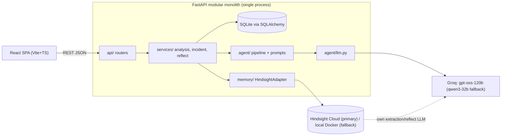
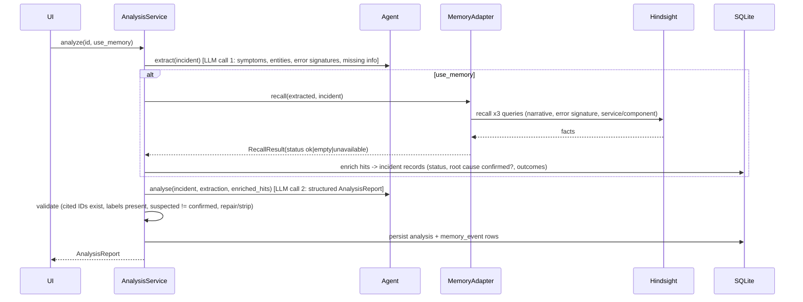

# architecture.md

## 1. Principles
1. **Hindsight finds, the app DB verifies.** Hindsight provides associative recall/synthesis; our SQLite DB is the source of truth for incident status, root-cause confirmation and outcomes. The agent may only cite incidents that exist in the DB.
2. **Contract first.** `backend/app/contracts.py` (Pydantic) is canonical; frontend types are generated from OpenAPI.
3. **One seam per external system.** Only `app/memory/` imports the Hindsight SDK; only `app/agent/llm.py` imports the LLM SDK. Both have `fake` implementations so all workstreams run on day 0.
4. **No framework tax.** Plain functions for the agent pipeline. No LangChain/agent frameworks. No tool-calling dependency (O3 warns about function-calling errors) — we use JSON-schema-validated completions with one repair retry.
5. **Advisory, evidence-labelled output.**

## 2. High-level architecture

## 3. Component responsibilities
| Component | Owns | Must not |
|---|---|---|
| `api/` | HTTP, validation, error mapping | business logic |
| `services/` | orchestration, transactions, enrichment (recall hit → DB incident), validation of agent output | call SDKs directly |
| `db/` | models, repo functions, seed loader | know about Hindsight |
| `memory/` | retain/recall/reflect, query construction, memory text templating, hit normalisation, retries/timeouts | leak SDK types |
| `agent/` | extraction + analysis prompts, schema validation, repair retry | touch DB or Hindsight |
| `frontend/` | UI only; typed API client | hold secrets |

## 4. Agent execution flow — `POST /api/incidents/{id}/analyze`

Memory-OFF = identical pipeline with the recall step skipped (same model, same prompts, same incident) so the A/B is controlled and honest.

## 5. Hindsight memory lifecycle
| Event | Action | Notes |
|---|---|---|
| Incident submitted | **No retain.** | Unverified hypotheses and live chatter must not pollute memory. |
| Incident resolved (root cause + outcome entered by engineer) | **Retain** one structured narrative per incident (`document_id = incident id`). | Includes failed approaches and lessons. |
| Root cause revised later (P1) | Retain a *correction* note referencing the incident ID + new timestamp; app DB marks old root cause `superseded`. | Agent rule: later correction wins; contradictions shown. |
| Engineer feedback on a recommendation (P1) | Retain short "experience" note. | |
| Analysis report text | **Never retained.** | Avoids feedback loops of LLM opinion becoming "memory". |
| New analysis | **Recall** (3 queries) | |
| Pattern view / after each resolve | **Reflect** | |

**What an incident memory is:** a *closed, engineer-confirmed* incident record. Chats, drafts and agent outputs are not incident memories.

## 6. Preventing false historical associations (Design Q-B)
1. Recall returns *candidates*, never conclusions.
2. LLM must rate each candidate `strong|partial|weak|unrelated` and list matching features **and differences**.
3. App DB join: root cause shown as "confirmed" only if DB status is `confirmed`; otherwise "suspected".
4. Post-validation strips any incident ID not in DB and any claim without a label.
5. If no candidate ≥ partial → UI shows "No relevant historical memory found" (never invented).
6. Prompt rule: similar symptoms ≠ same cause; always include "what would distinguish them" as a TO_VERIFY step.

## 7. Failure handling
| Failure | Behaviour |
|---|---|
| Invalid request | 422 with field errors (see api-contracts). |
| LLM timeout/rate limit/invalid JSON | 1 repair retry → fallback model → `503 LLM_UNAVAILABLE`; incident remains saved. |
| Hindsight recall error/timeout (8 s) | Analysis proceeds, `memory.status="unavailable"`, red banner "analysis without historical memory". |
| Recall empty | `memory.status="empty"`; explicit "no relevant history". |
| Retain fails | Resolve still succeeds; `retain_status="pending"`; background retry ×3 + manual `POST /retain`. UI shows "memory not yet updated". |
| Reflect fails | 200 with `status="unavailable"`; cached last pattern result shown with timestamp. |
| Ambiguous incident | Extraction returns `missing_information`; analysis lists it first and lowers relevance ratings. |

## 8. Deployment
P0: `docker compose up` (or `make dev`) runs backend + frontend locally. P1: one container (FastAPI serving built SPA) on Render/Fly/Railway; SQLite on a volume; env via platform secrets. Demo must also run from one laptop with the seeded DB and cached fallback responses.

## 9. Observability
Structured JSON logs; `memory_events` table (op, status, latency, incident) exposed at `GET /api/memory/events` and shown in a **Memory Trace** panel — doubles as demo evidence of Retain/Recall/Reflect.

## 10. Security
`.env` (gitignored) + `.env.example`; keys server-side only; CORS restricted to frontend origin; run `gitleaks`/GitHub secret scanning before first push; synthetic data only.
