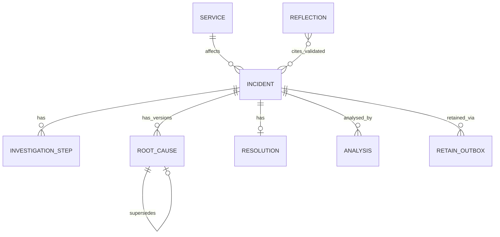

# data-model.md  (v1.1 — revised after review; see "Changes" at bottom)

## 1. Ownership
| Store | Owns | Authoritative for |
|---|---|---|
| **App DB (SQLite, SQLAlchemy 2.x)** | services, incidents, steps, root causes, resolutions, analyses, outbox, reflections, memory events, app_meta | incident status, root-cause confirmation, outcomes, revision, **what has/has not been retained** |
| **Hindsight bank** | facts/observations *extracted by Hindsight* from retained narratives | associative recall + reflection only. Hindsight stores extracted facts, not our text verbatim [D: retain docs]. |

Rule: if they disagree, SQLite wins and the disagreement is shown, never hidden. SQLite runs with `PRAGMA foreign_keys=ON` and WAL; the app runs **one uvicorn worker** (outbox claim is also compare-and-set, so a second worker would still be safe).

## 2. Entities

| Table | Fields |
|---|---|
| `services` | `name` PK (slug), `description?`, `owner_team?` |
| `incidents` | `id` PK `INC-###`, `title`, `description`, `service` FK, `severity` SEV1–4, `status` open/resolved, `error_messages` JSON[], `evidence` text, `metadata` JSON, `occurred_at`, `created_at`, `resolved_at?`, `lessons_learned?`, `revision` int (=1; +1 per correction, P1 feature, column exists in P0) |
| `investigation_steps` | `id`, `incident_id`, `seq`, `action`, **`category`** (controlled list below, default `other`), `outcome` tried/effective/partial/ineffective/ruled_out, `notes?` |
| `root_causes` | `id`, `incident_id`, `description`, `status` confirmed/suspected/ruled_out/superseded, **`cause_key?`** (engineer-entered slug, e.g. `commons-db-2.3.0-retry-leak`; used only to *verify* cross-incident claims), `supersedes_id?`, `revision`, `created_at`. **Authoritative root cause = latest row with status ≠ superseded.** |
| `resolutions` | `id`, `incident_id`, `actions_taken`, `outcome` effective/partial/ineffective, `verified` bool, `revision` |
| `retain_outbox` | see §3 |
| `analyses` | `id`, `incident_id`, `mode` memory_on/off, `report` JSON, `model`, `created_at` |
| `reflections` | `id`, `generated_at`, `latency_ms`, `question`, `budget`, `resolved_count_at_generation`, `raw_text`, `raw_structured_json?`, `raw_based_on_json?`, `validated_json` (the `ReflectResult` body shown to users), `usage_json?`. **Only successful generations are stored here.** |
| `memory_events` | append-only: `id`, `ts`, `op` retain/recall/reflect, `status` pending/ok/empty/error, `latency_ms?`, `incident_id?`, `outbox_id?`, `attempt?`, `error_kind?`, `summary`, `error?` |
| `app_meta` | `key`/`value`: `bank_id` (the Hindsight bank this DB is bound to), `schema_version`, `seeded_at?` |

**Controlled `category` list** (shared by investigation steps and recommendations; frozen with contracts): `increase_pool_size, increase_db_capacity, adjust_proxy_pool, restart, check_library_version, upgrade_dependency, check_connection_leak, check_slow_queries, check_db_capacity, check_recent_deploy, check_config, rollback, other`.

## 3. Retention lifecycle — `retain_outbox` (single canonical definition)
Columns: `id` (uuid) · `incident_id` · `kind` (`resolution` | `correction`) · `revision` · `document_id` (= incident id) · `content` (narrative **frozen at enqueue**, so what is retained equals what was committed) · `content_sha256` · `status` · `attempts` · `max_attempts` (=5) · `next_attempt_at` · `claimed_at?` · `last_error?` · `last_error_kind?` (transient/permanent/unexpected) · `result_json?` (normalised retain result: items_count, token usage, latency) · `created_at` · `updated_at` · `completed_at?`. **UNIQUE(incident_id, kind, revision).**

**Row status values (the only four):** `pending` → `in_progress` → `succeeded` | `failed`.

| Transition | Trigger | **Owner (only this code may do it)** |
|---|---|---|
| ∅ → `pending` | engineer resolves incident; inserted **in the same SQLite transaction** as the resolution | `services/incident_service.resolve()` (WS-B) |
| `pending` → `in_progress` | worker claim: `UPDATE … SET status='in_progress', claimed_at=now WHERE id=? AND status='pending' AND next_attempt_at<=now` (rowcount 1 = claimed); an incident never has two rows in flight | `services/outbox.py` (WS-B) |
| `in_progress` → `succeeded` | adapter returned `RetainResult.status="ok"` | `services/outbox.py` |
| `in_progress` → `pending` | adapter error `transient` and attempts < max: `attempts+1`, `next_attempt_at = now + [5s,15s,45s,2m,5m][attempts]` | `services/outbox.py` |
| `in_progress` → `failed` | error `permanent`/`unexpected`, or attempts == max | `services/outbox.py` |
| `in_progress` → `pending` (**lease expiry**) | `claimed_at` older than 180 s (process died mid-attempt); counts as an attempt | `services/outbox.py` |
| `failed` → `pending` | engineer clicks retry (`POST /incidents/{id}/retain`); `attempts=0`. Rejected (409) if latest row is pending/in_progress; no-op 200 if succeeded. | `api/` → `services/outbox.requeue()` |

The adapter **never** touches the outbox and never uses these words: it returns `ok | error` + `error_kind`.

**Derived `retain_status` (API field) — never stored, so it cannot contradict the DB:** no outbox rows → `not_applicable`; latest row (highest revision, then created_at) is `pending`/`in_progress` → `pending`; `succeeded` → `synced`; `failed` → `failed`.

**Crash windows:** (1) crash after commit, before first attempt → row stays `pending`; worker (started at boot and ticking every 10 s) picks it up. (2) crash mid-attempt → lease expiry reclaims it. (3) crash after Hindsight accepted but before we mark `succeeded` → retry re-sends the same `document_id`; documented upsert semantics replace the previous document, so no duplicate memories [D; confirm by L7]. Delivery is therefore **at-least-once with idempotent document upsert**.

## 4. Correction semantics (data integrity is P0; the UI flow is P1)
- Correcting a root cause creates a new `root_causes` row (`supersedes_id` set, old row → `superseded`), increments `incidents.revision`, and enqueues an outbox row `kind=correction, revision=N` whose `content` is the **complete corrected narrative**, re-retained with the **same `document_id` and `update_mode="replace"`** (documented: old document and its facts are deleted, new content processed [D]).
- Authoritative version = SQLite latest non-superseded rows. Hindsight text is never displayed as truth: root cause and outcome in cards come from SQLite; Hindsight snippets are labelled "memory snippet".
- Until the correction outbox row is `succeeded`, any recalled snippet for that incident whose revision is unknown or older shows the badge "incident corrected after this memory was recorded — see authoritative record". Narratives end with `Record revision: N`; the adapter parses it when present.
- If SQLite correction commits but Hindsight update fails → outbox `pending/failed` → badge persists and Memory Trace shows it. Whether observations consolidated from the old facts are invalidated after replace is **unverified (L7)**; until verified, the badge rule above covers it.
- P0 does not expose the correction UI; the schema and outbox `kind` exist so P1 needs no migration.

## 5. Hindsight-managed content
One narrative per incident revision: `document_id = INC-###`, `metadata = {incident_id, service, root_cause_status, revision}`, `tags = ["incident:INC-###"]` (formats in hindsight-integration.md §5). Hindsight extracts facts (and later consolidates observations); we do **not** rely on it returning our text, only on `document_id`/`metadata`/`tags` provenance on recall hits [S: fields exist; L4 to verify they are populated].

## 6. Banks and reset safety
`app_meta.bank_id` binds a SQLite file to one bank; on boot if `HINDSIGHT_BANK_ID` ≠ `app_meta.bank_id` the memory layer reports `bank_mismatch` (analysis degrades; nothing is written). Allowed bank IDs: `^srma-(demo|dev|eval|spike)-[a-z0-9-]+$`; `srma-demo-YYYYMMDD-NN` are **versioned and never reused**. **App code never deletes or clears a Hindsight bank** (the adapter interface has no such method; CI greps for `delete_bank|clear_bank_memories|aclear` outside `spike/`). "Reset the demo" = create a new SQLite file + a new `srma-demo-…-NN` bank via CLI (api-contracts §CLI); old banks are removed by a human in the Cloud console if desired.

## Changes in v1.1
Added `retain_outbox`, `reflections`, `app_meta`; added `cause_key` (root_causes) and `category` (steps); added `revision`; removed stored `incidents.retain_status` (now derived); `memory_events` gained `pending` status, `outbox_id`, `attempt`, `error_kind`.
